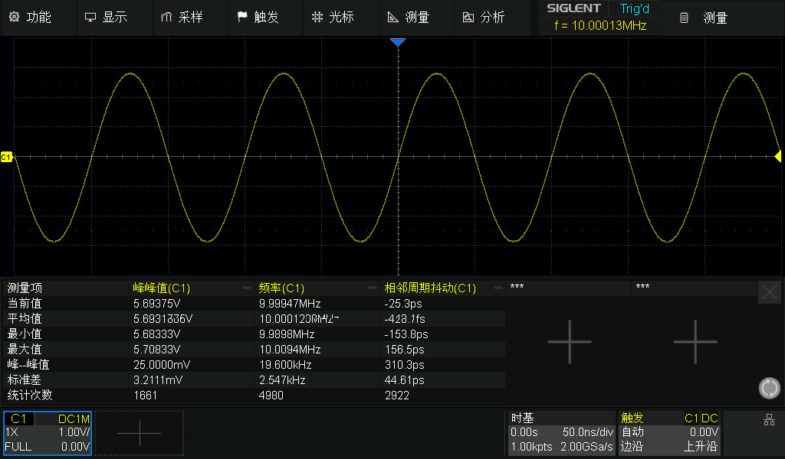
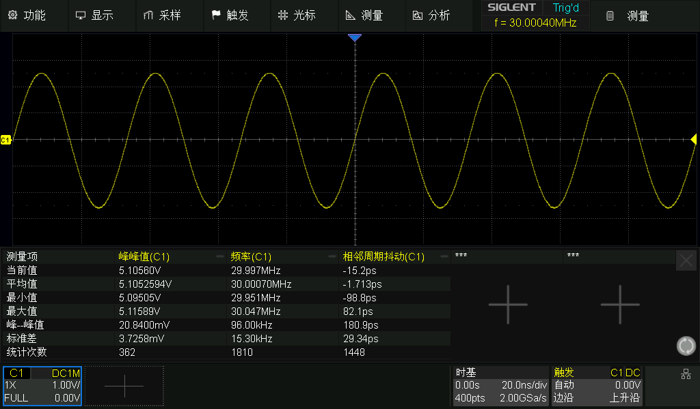
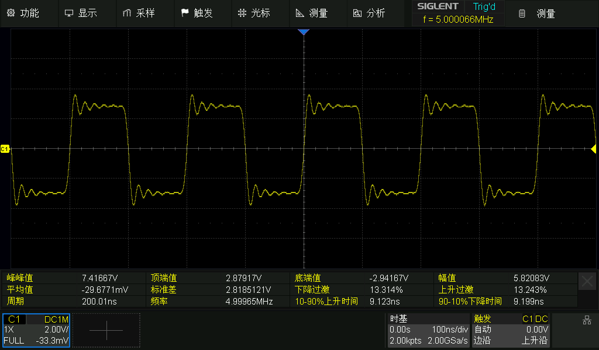
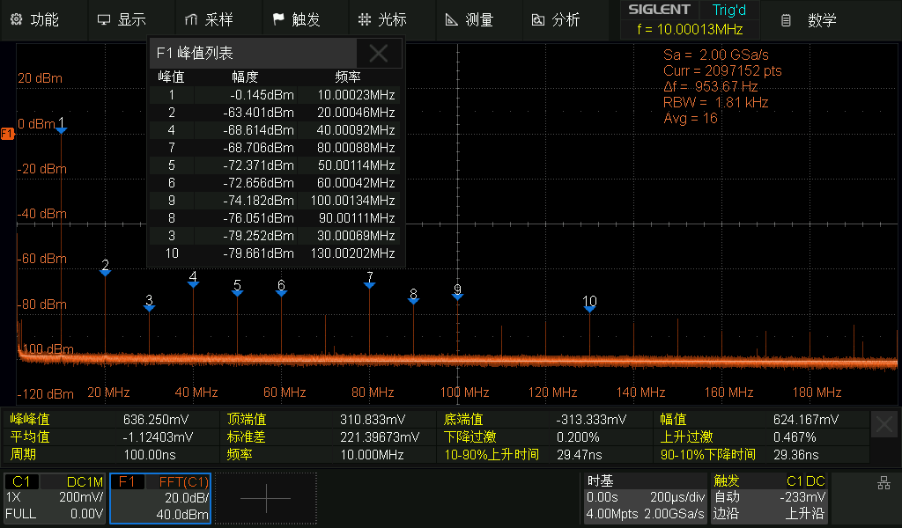

<div align="center">

<!-- Assisted-by: DeepSeek - document framework -->

# ArbWave30
30MHz Arbitrary Waveform Generator | FPGA + High-Speed DAC | SCPI Control

<p align="center">
  <a href="https://github.com/EERNINUO/ArbWave30" style="margin: 2px;">
    
  </a>
  <a href="https://github.com/EERNINUO/ArbWave30" style="margin: 2px;">
    
  </a>
  <a href="https://github.com/EERNINUO/ArbWave30" style="margin: 2px;">
    
  </a>
  <br/>
  <a href="https://raw.githubusercontent.com/EERNINUO/ArbWave30/main/LICENSE" style="margin: 2px;">
    
  </a>
  <a href="https://raw.githubusercontent.com/EERNINUO/ArbWave30/main/LICENSE" style="margin: 2px;">
    
  </a>
    <a href="https://raw.githubusercontent.com/EERNINUO/ArbWave30/main/LICENSE" style="margin: 2px;">
    
  </a>
  <!-- <a href="https://github.com/EERNINUO/ArbWave30/releases" style="margin: 2px;">
    
  </a> -->
</p>
</div>

---

> **⚠️ Warning**: You are viewing the **develop** development branch; its contents may be unstable.
> For a stable version, use the [releases branch](https://github.com/EERNINUO/ArbWave30/tree/releases).

## ⚠️ Update Status
The author is currently taking part in "0854 Doesn't Believe in Tears", so updates to this project are paused. Updates are promised to resume on 2026.12.25, along with the first Release. (Why not on the 20th? After finally being free, surely I deserve a few days of fun!)

## ✨ Features

### Hardware Specifications (V1.0)
- Waveforms: sine, square, triangle, noise, DC
- Sine waves up to **30MHz**, square waves up to **5MHz**
- Voltage range (high impedance): 20Vpp (DC\~10MHz), 14Vpp (10\~20MHz), 10Vpp (20\~30MHz)
- Amplitude resolution: 2mV (typical), offset range ±10V
- Total harmonic distortion (THD): < -50dBc @10MHz, full amplitude (target)
- Phase noise: -100dBc/Hz @10kHz offset (30MHz carrier) (target; cannot currently be characterized due to test equipment limitations)
- Output impedance: 50Ω
- Reference clock: internal TCXO (±1ppm) or external 10MHz input

### Hardware Specifications (MVP)
- Waveforms: sine, square, triangle, noise, DC
- Sine waves up to **30MHz**, square waves up to **5MHz**
- Voltage range (high impedance): 4Vpp (DC\~10MHz), 2.8Vpp (10\~20MHz), 2Vpp (20\~30MHz)
- Amplitude resolution: 2mV (typical), offset range ±2V
- Total harmonic distortion (THD): < -50dBc @10MHz, full amplitude (target)
- Phase noise: -80dBc/Hz @10kHz offset (30MHz carrier) (target; cannot currently be characterized due to test equipment limitations)
- Output impedance: 50Ω
- Reference clock: internal TCXO (±1ppm)

### Control and Interfaces
- USB 2.0 (USB CDC class), supporting the SCPI-1999 command set
- SMA output, SMA trigger I/O, SMA external clock input
- Power input: 24V DC, power consumption <24W

### Software and Expansion Roadmap
- V1.0: single channel + basic waveforms + core SCPI commands
- V2.0: dual channel + modulation + frequency sweep
- V3.0: Linux GUI + arbitrary waveforms (16kpts)

---

## 🚦 Project Status

> **Current stage: validation of the MVP hardware and core MCU/FPGA code is complete. Output can now be controlled through SCPI; further analog front end tuning is underway.**

### ✅ Completed
- [x] PCB design and prototype fabrication (4-layer board, signal-integrity design)
- [x] Analog front end bring-up passed
- [x] DAC power-up configuration working correctly (stable SPI communication)
- [x] Sine-wave DDS core (IP core implementation, 48-bit phase accumulator)
- [x] Square/DC/triangle/noise waveform generation
- [x] Amplitude control module
- [x] Phase control module
- [x] SPI slave communication interface and register bank
- [x] Analog board driver library (MCU side)
- [x] SCPI protocol stack port
- [x] 7th-order elliptic filter assembly and bring-up
- [x] Preliminary output performance characterization (THD, SFDR)
- [x] Software amplitude calibration

### 🏗️ In Progress
- [ ] Harmonic performance optimization

### 📋 To Do (After MVP)
- [ ] Filter performance optimization (reconstruction filter; adjust group delay to reduce overshoot/ringing on fast edges)
- [ ] Revise the board partitioning (power board, analog board, control board)
- [ ] Full analog board design (add hardware amplitude control, DC offset, external trigger, external clock input)
- [ ] Precise output performance characterization (requires a professional spectrum analyzer; currently unavailable)
- [ ] Host control software

### 📸 Current Progress

**Sine-wave output (measured with an SDS824X HD oscilloscope):**

**Full-amplitude sine-wave output:**



**Full-amplitude square-wave output:**

> The current version has approximately 13.5% square-wave overshoot due to the filter's group-delay characteristics. This will be addressed by optimizing the channel design; see the [Reconstruction Filter Debugging Notes](docs/design-notes/reconstruction-filter-debugging.md).

**10MHz sine-wave FFT results:**



The measurements above yield[^1]:
  THD ≈ -60.2 dBc @10MHz,
  SFDR[^2] ≈ 63.26 dBc @10MHz

[^1]: Harmonics introduced by the oscilloscope itself are not negligible, so these values are for reference only. Actual performance must be remeasured with a spectrum analyzer.

[^2]: There are two definitions of SFDR: 1, including harmonics; 2, excluding harmonics. Since the table contains no nonharmonic components, the first definition is used.

---

## ⚠️ Known Issues
- The current version has approximately 13.5% square-wave overshoot due to the filter's group-delay characteristics. This will be addressed by optimizing the filter design.
- After running for some time, the current version may exhibit offset jumps of a fixed magnitude and direction when outputting sine waves above 25 MHz. FPGA heating is suspected to cause timing drift; planned remedies include refining FPGA timing constraints and improving cooling.
- The current board partitioning makes the assembled unit too long and narrow (approximately 225mm x 90mm). A future revision will use separate power, analog, and control boards.

## 🧱 Repository Structure
```text
ArbWave30/
├── docs/ # Design documentation
│    ├── pic/ # Documentation images
│    ├── adr/ # Architecture decision records
│    ├── diagrams/ # Editable block diagrams
│    ├── hardware-design/ # Hardware design documents
│    ├── design-notes/ # Design notes
│    ├── debug-notes/ # Debugging notes
│    ├── user-manual/ # User manuals
│    └── LICENSE # CC BY-SA 4.0
├── hardware/ # Schematic and PCB source files
│    ├── analog_board/ # Analog board PCB design
│    ├── control_board/ # Control board PCB design
│    └── LICENSE # CERN-OHL-S-2.0
├── firmware/
│    ├── FPGA/ # FPGA design source code (Verilog)
│    │    ├── Application/ # Application code
│    │    └── FPGA_Test_Hardware/ # FPGA hardware test code
│    │         ├── FPGA_Clodck_Test/ # Clock test code
│    │         └── FPGA_Hardware_Test/ # FPGA hardware test code
│    ├── MCU/ # MCU firmware source code (C/C++)
│    │    ├── Application/ # Application code
│    │    ├── MCU_Test_Hardware/ # MCU hardware test code
│    │    │    └── min_system_test/ # MCU minimum-system test code
│    │    └── SCPI_Test/ # SCPI-parser port test project
│    └── Clock_Generator_Config/ # Clock generator configuration
├── simulink/ # LTspice simulation files
├── datasheets/ # Component datasheets and reference designs
├── scripts/ # Automated test scripts (PyVISA)
│    ├── test_filter/ # Filter test scripts
│    └── test_diff_to_single # Differential-to-single-ended output test scripts
├── LICENSE # GPL-3.0
└── README.md
```
---

## 🚀 Getting Started

> The project is in the **minimum viable product (MVP) validation stage; future changes may break compatibility**. MVP hardware/software integration testing is underway. Once validation is complete, the following will be provided:
> - PCB Gerber files and BOM for prototype fabrication
> - FPGA bitstream programming instructions (loading through JTAG)
> - Firmware build and update instructions

Browse the design documents in `docs/` for detailed technical specifications and design rationale.
You can also explore the schematics and PCB files in `hardware/` and the code framework in `firmware/` to understand the hardware and software architecture. Feedback is welcome.

---

## 📡 SCPI Command Example

```python
import pyvisa

# 1. Select the pure-Python backend (no NI-VISA driver required).
rm = pyvisa.ResourceManager('@py')

# 2. List all resources to find your COM port (typically in a format such as 'ASRL3::INSTR').
# print(rm.list_resources())

# 3. Open the serial resource and configure terminators.
inst = rm.open_resource('ASRL3::INSTR')  # Replace with the actual ASRL port number.
inst.baud_rate = 115200        # Serial baud rate; not important for USB CDC devices.
inst.read_termination = '\n'   # Important: declare explicitly even though '\n' is the default.
inst.write_termination = '\n'  # Automatically append a newline when sending.

# 4. Use query as with a USBTMC instrument.
print(inst.query('*IDN?'))
inst.write('SOUR:FREQ 1000')
inst.write('SOUR:STAT ON')

# 5. Query.
freq = inst.query('SOUR:FREQ?')
print(f"Freq: {freq}")

inst.close()
```

See the [SCPI Reference](docs/user-manual/scpi-reference.md) for the complete command set.

## 🧪 Automated Testing
Test scripts are located in `scripts/` (under active development) and use PyVISA to communicate with the device. Run the relevant scripts for automated testing, or use them as a basis for your own test cases.

## 📄 Documentation
Design documents, test reports, and user manuals are located in `docs/` and are continually updated.

## 📅 Version Roadmap
| Stage | Function | Description |
|------|------|------|
| V1.0 | Single channel, basic waveforms (sine, square, triangle, noise, DC) | Continuously adjustable frequency, amplitude, offset, and phase; SCPI support (a small core command set) |
| V2.0 | Dual channel | Add a second output with frequency/phase synchronization and adjustable phase difference |
| | AM modulation | Internal/external modulation source, modulation depth 0\~100% |
| V3.0 | Embedded GUI | Linux + LVGL, direct control through an LCD touchscreen |
| | Arbitrary waveforms | User-defined waveform tables, storage depth ≥16kpts |

## 📜 Licensing
Copyright © 2026 EERNINUO

This project uses **multiple licenses**, with different licenses applying to different components:

| Component | License |
|----------|--------|
| Firmware (MCU/FPGA code) | [GNU General Public License v3.0](LICENSE) |
| Hardware design files (schematics, PCB, BOM) | [CERN Open Hardware Licence Version 2 - Strongly Reciprocal](hardware/LICENSE) |
| Documentation, images, README | [Creative Commons Attribution-ShareAlike 4.0 International](docs/LICENSE) |

This means:
- You may use, modify, and share the firmware code, but derivative code must also be released as open source under GPL-3.0.
- You may manufacture and distribute physical devices based on the hardware design files, but you must also publish your modifications to the design files and retain attribution.
- You may copy and modify the documentation, but must share it under CC BY-SA 4.0 and credit the original author.

**Trademark notice**: the `ArbWave30` name and logo may not be used for commercial products without authorization.

## 🤖 AI Assistance Disclosure

The documentation framework for this project was created with assistance from GitHub Copilot / DeepSeek.
The author has reviewed and tested each part, but please open an issue if you encounter any problems.

## ⚠️ Disclaimer
This is a personal learning and open-source project; commercial-grade reliability is not guaranteed. Please read the disclaimer carefully before use.

## 📫 Contact
Project homepage: https://github.com/EERNINUO/ArbWave30

## ⭐ Star History
If you find this project helpful, please give it a star ⭐. Thank you!
