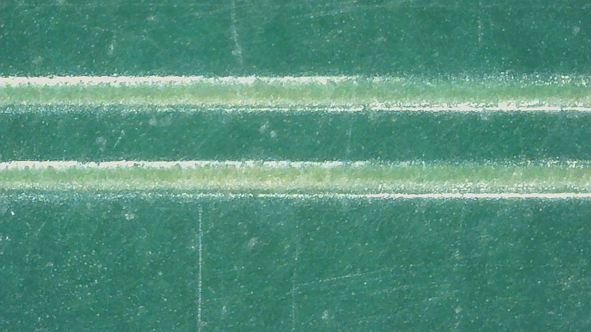
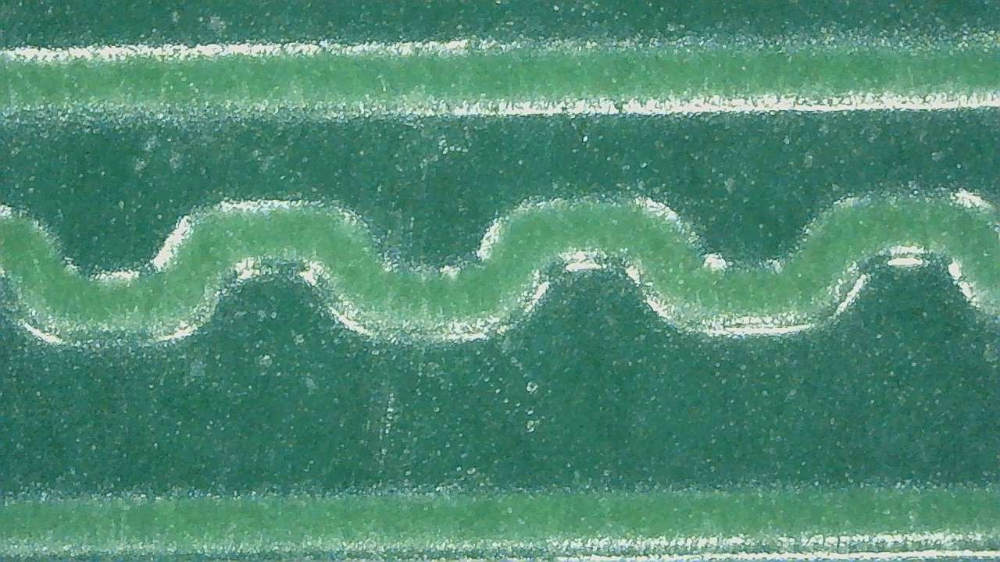
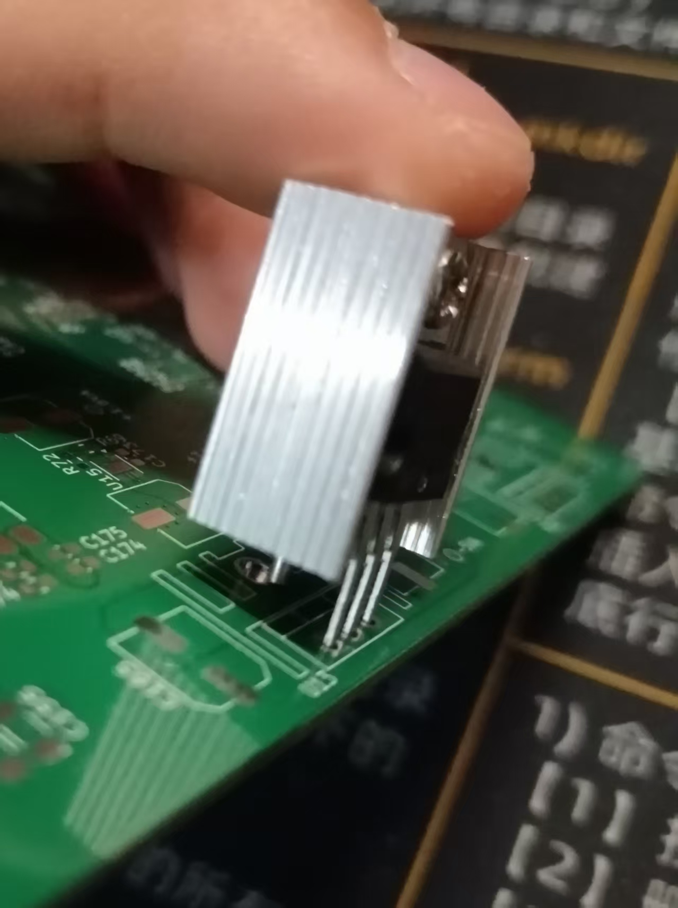

<!------------------------------------------------------------------------
SPDX-License-Identifier: CC-BY-SA-4.0
Copyright (C) 2026 [EERNINUO]

This work is licensed under the Creative Commons Attribution-ShareAlike 4.0 International License. 
To view a copy of this license, visit http://creativecommons.org/licenses/by-sa/4.0/.
------------------------------------------------------------------------->

<!-- Assisted-by: DeepSeek - document framework -->

# ArbWave30 - Analog Board MVP Debugging Notes

## Visual Inspection
- **Date**: June 13, 2026.
- **Hardware version**: v0.1.0-mvp.
- **Purpose**: check for PCB manufacturing defects and verify that footprints match the physical components.
- **Tools**:
  1. Digital microscope.
  2. Soldering materials.
- **Checklist**:

| No. | Inspection | Result | Notes |
| ---- | ---- | ---- | ---- |
| 1 | Verify footprints against physical components | ⚠️ Attention | Incorrect heatsink footprint (see findings below) |
| 2 | Check solder-mask color uniformity | ⚠️ Attention | Some narrow traces appear yellowish (see findings below) |
| 3 | Check for broken traces | ✅ Pass | Normal trace continuity |
| 4 | Silkscreen clarity and placement | ⚠️ Attention | Additional silkscreen markings could be useful (see findings below) |

### Findings

1. **Localized yellowing of solder mask over narrow traces**

   **[Observation]** The digital microscope revealed:

   
   - The solder mask over the differential clock traces (CLK_P/N, 6mil width) is pale yellow, visibly different from the surrounding green solder mask.
   - The same effect occurs on three other isolated traces ≤6mil wide. Dense routing areas (such as the FPGA-DAC interface) and copper pours have normal solder-mask color, as shown below.

   
   - Wiping with alcohol does not change the color, ruling out surface contamination.

   **[Analysis and hypothesis]**
   - Preliminary assessment: the yellow color is not degraded solder mask, but copper showing through the semitransparent mask. Concentrated current density during electroplating increases local copper thickness on narrow traces. The raised surface reduces the effective solder-mask thickness, allowing the copper color to show through.
   - Functional risk: electrical continuity is currently unaffected, but mechanical protection and insulation strength are reduced, making these areas more susceptible to scratches or moisture corrosion during assembly and long-term use.
   - Signal-integrity risk: copper thickness variation slightly changes differential impedance. The effect on reflection margin for the 150MHz clock is limited, but should receive particular attention in subsequent measurements.

   **[Action plan]**
   - Electrical verification: measure insulation resistance between adjacent narrow traces with a multimeter (>20MΩ, passed).
   - If signal quality problems occur in later tests, investigate this issue first.
   - If no problems occur, this issue can be disregarded, but take special care to protect these areas during assembly.

2. **Incorrect heatsink footprint**

   

   **[Observation]** The heatsink footprint does not match the physical part.
   - The heatsink representation is too thin, causing an assembly interference.

   **[Action plan]**
   - Bend the regulator leads to resolve the assembly interference.
   - Correct the footprint to match the actual heatsink thickness.
   - Downstream power dissipation is modest. The MVP retains heatsinks as a precaution; they may be removed later if measurements justify it.

3. **Optional silkscreen additions**

   **[Observation]** The JTAG debug connector lacks silkscreen pin-order markings, so connecting individual jumper wires requires consulting the layout.

   **[Action plan]**
   - Add pin-order markings to the silkscreen for easier debugging.
