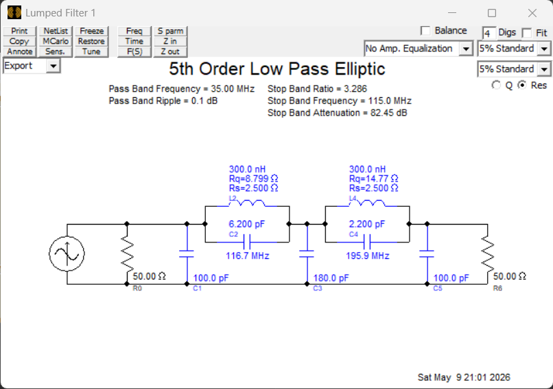
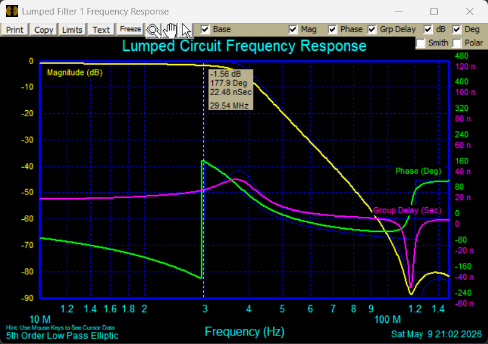
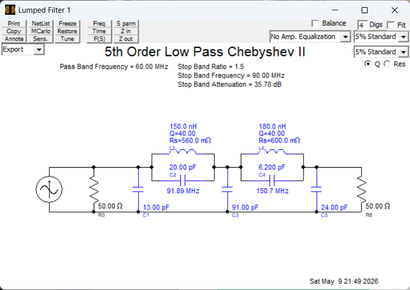
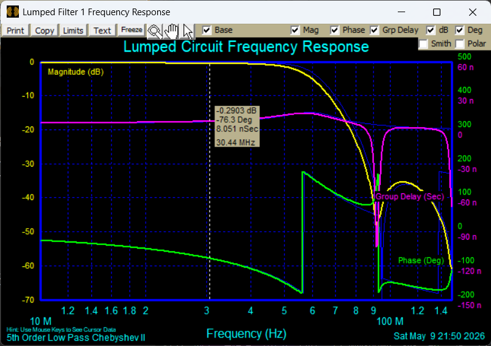
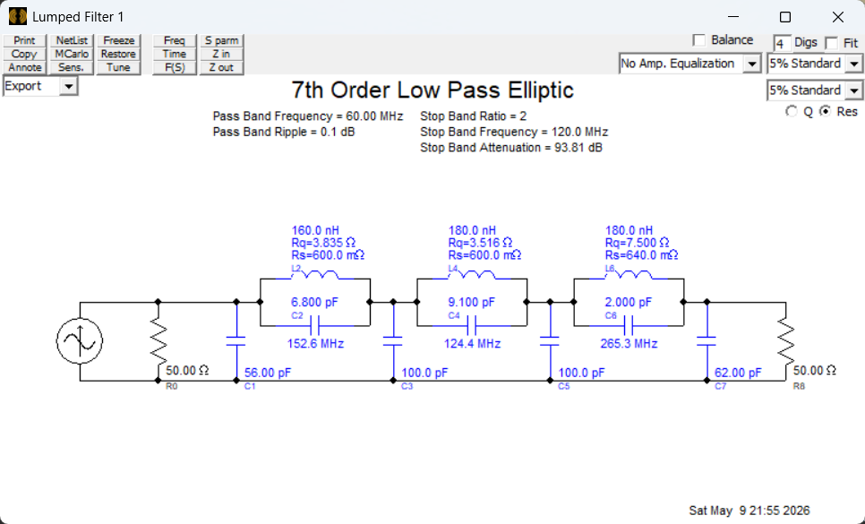
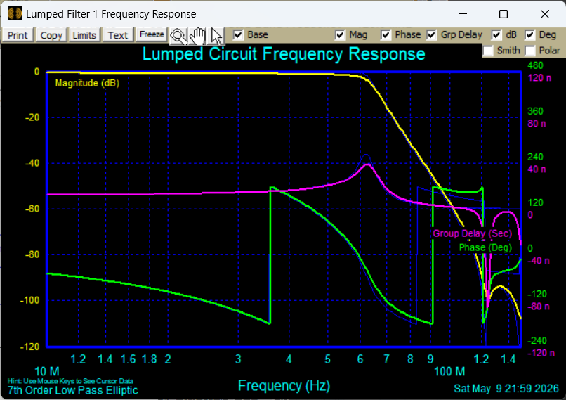
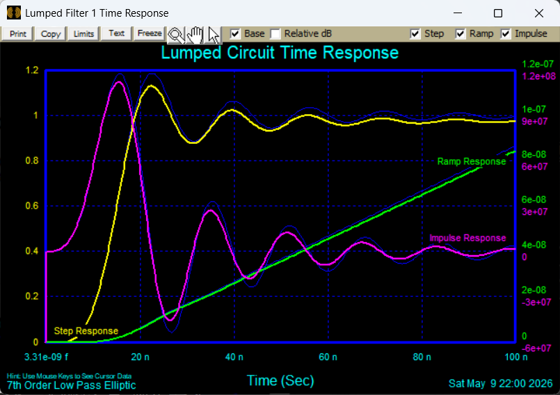
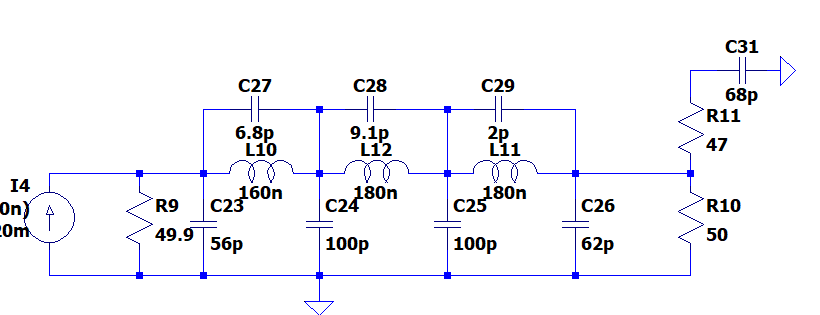
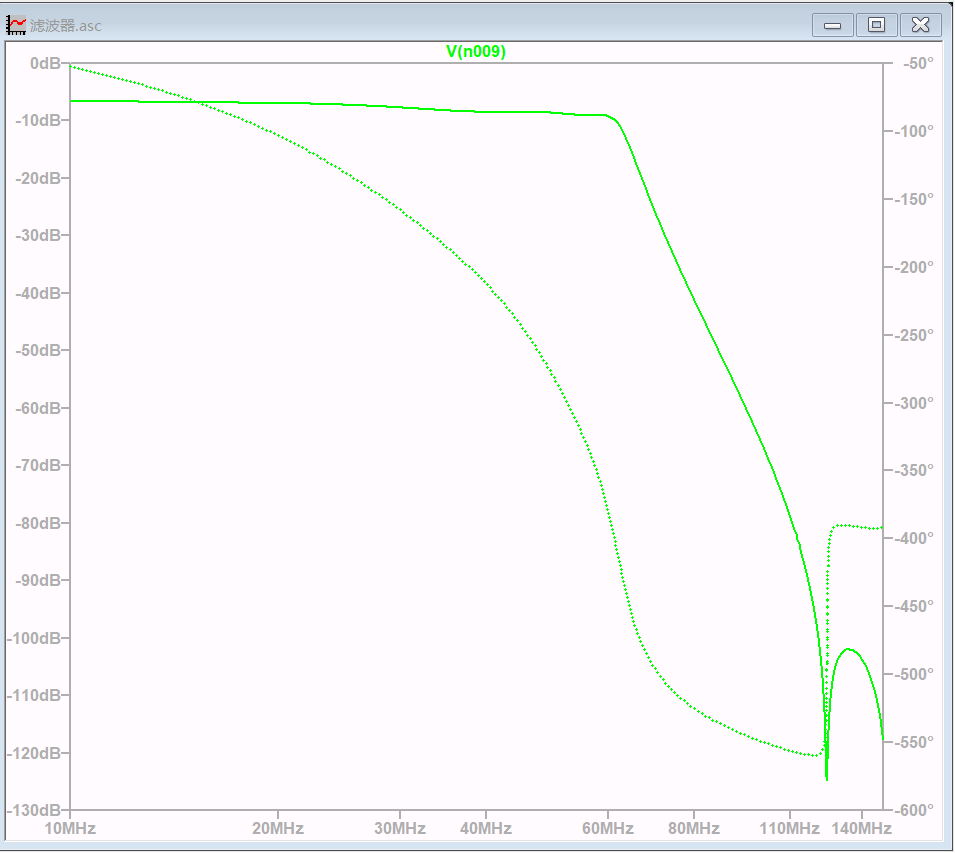
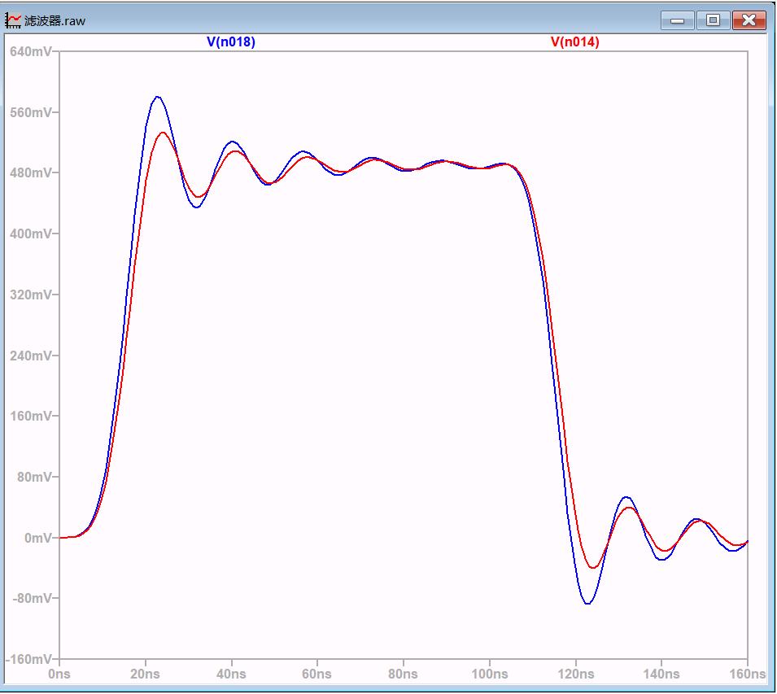

<!------------------------------------------------------------------------
SPDX-License-Identifier: CC-BY-SA-4.0
Copyright (C) 2026 [EERNINUO]

This work is licensed under the Creative Commons Attribution-ShareAlike 4.0 International License. 
To view a copy of this license, visit http://creativecommons.org/licenses/by-sa/4.0/.
------------------------------------------------------------------------->

# Reconstruction Filter Debugging Notes

## 2026-05-08
- Goal: design a reconstruction filter for the AD9747 (150MSPS), with a 0\~30MHz passband and >60dB rejection of the 120MHz image.
- Initial attempt: 5th-order elliptic filter, 35MHz cutoff. Simulation with ideal inductors gives a flat passband and 120dB stopband rejection at 120MHz.
- Problem: with real inductor models (AWH1608C, Q≈25, DCR≈2\~3 Ω), insertion loss reaches 0.7dB at 30MHz, failing the passband requirement.
- Cause: inductor Q is too low and DCR is too high.

## 2026-05-08
- Replace inductors with AHW2012.
- Insertion loss is approximately 0.45dB at 30MHz, close to the limit. Actual component performance may be less favorable, so the risk is significant.

## 2026-05-08
- Try raising the cutoff frequency to 60MHz.
- At 60MHz, the required inductance is smaller (approximately 120\180nH), with correspondingly lower DCR (approximately 0.4\~0.7Ω). Insertion loss drops to 0.2dB at 30MHz.
- However, rejection of the 120MHz image drops to 35dB, failing the requirement.

## 2026-05-09 (Current Best Approach)
- Change to a 7th-order elliptic filter with a 60MHz cutoff.
- Insertion loss is approximately 0.2dB at 30MHz, and attenuation at 75MHz is approximately 20dB, meeting the requirements.
- However, the 7th-order elliptic filter has 13% square-wave overshoot (5MHz square wave; approximately 18% in LTSpice simulation). The root cause is the group-delay peak of the elliptic filter.

## 2026-05-19
- Adding an output RC snubber (R=47Ω, C=68pF) reduces overshoot to approximately 8%.
- However, insertion loss at 30MHz increases to approximately 1.2dB, failing the requirement.

## Future Investigation
- Generate square waves through a separate channel that bypasses the reconstruction filter (v2.0 implementation).
- Adjust rise time in software to reduce high-frequency components.
- Apply software predistortion to compensate for the filter's nonideal response.
