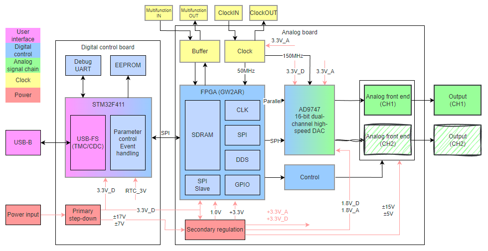
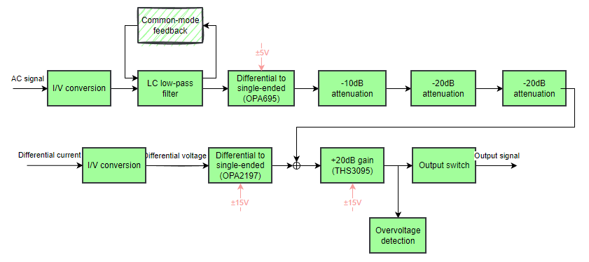
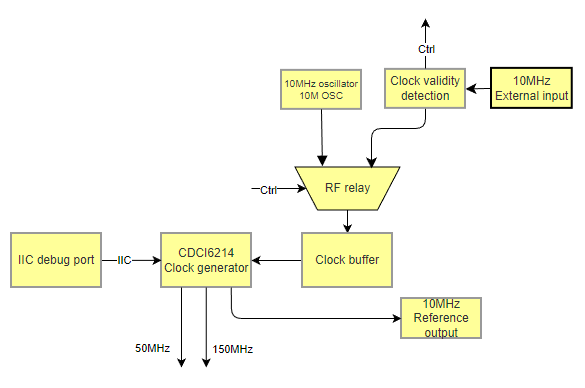
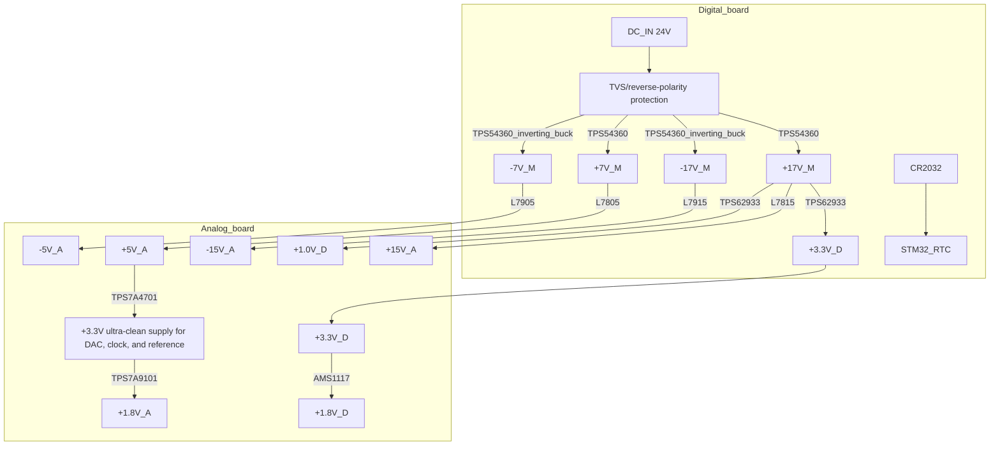

<!------------------------------------------------------------------------
SPDX-License-Identifier: CC-BY-SA-4.0
Copyright (C) 2026 [EERNINUO]

This work is licensed under the Creative Commons Attribution-ShareAlike 4.0 International License. 
To view a copy of this license, visit http://creativecommons.org/licenses/by-sa/4.0/.
------------------------------------------------------------------------->

<!-- Assisted-by: DeepSeek - document framework -->

# ArbWave30 Hardware Architecture

| Document ID | ArbWave30-HAD-001 | Version | V1.6 |
|---------|--------------|------|------|
| Project | ArbWave30 | Date | 2026-05-26 |
| Author | EERNINUO | Status | Draft |

> Translation scope: document text and editable block diagrams are in English. Original schematic screenshots, measurement captures, and photographs are preserved without pixel edits; any text embedded in those images remains as captured. Numerical values and historical design decisions are retained from the source documents.

## 1. Overview
ArbWave30 uses a **heterogeneous FPGA + MCU architecture**: the FPGA handles high-speed DDS waveform generation and real-time data processing, while the MCU handles USB communication, SCPI parsing, user interaction, and system status management. The analog front end has four stages: differential-to-single-ended conversion, reconstruction filtering, variable-gain amplification, and power output. The digital and analog sections use separate boards linked by board-to-board connectors to optimize signal integrity and power-supply noise.

## 2. System Block Diagram

## 3. Modules and Functional Definitions

### 3.1 Control Module (MCU) (Digital Board)
- **Part**: STM32F411 (tentative).
- **Responsibilities**:
  - USB TMC/CDC protocol stack.
  - SCPI command parsing and responses.
  - Non-real-time parameter storage (EEPROM emulation).
  - FPGA control (frequency, waveform, amplitude coefficient, phase, etc.).
  - Read user buttons/encoder (future GUI).
- **Interfaces**:

| Interface | Direction | Protocol | Connected to | Notes |
|--------|------|------|--------|------|
| USB_DP/DM | Bidirectional | USB 2.0 FS | PC | CDC or TMC |
| SPI1_CS/SCK/MOSI | Output | SPI | FPGA | Configure DDS parameters |
| INT | Input | GPIO | FPGA | FPGA status/interrupt output |
| GPIO | Output | GPIO | Buzzer, LED | Debugging |
| UART_TX/RX | Output | 115200 | Debug serial port | - |
| IIC_SDA/SCL | Bidirectional | I2C | EEPROM | Configuration storage |

### 3.2 Waveform Synthesis Module (FPGA + DAC) (Analog Board)
- **FPGA**: Gowin GW2AR-LV18 (LQFP-144).
- **Responsibilities**:
  - DDS phase accumulator (48bit, meeting 1μHz resolution).
  - Waveform memory (ROM/RAM): preset sine, square, triangle, noise, and DC waveforms.
  - Digital amplitude control (control the attenuation network and DAC output amplitude).
  - Parallel-interface timing generation for the DAC.
  - Real-time frequency/phase/amplitude word updates (glitch-free).
- **DAC**: AD9747 (16bit, maximum 250MSPS; reduced to 150MSPS to account for FPGA performance; dual channel, currently using channel A only).
- **Interfaces**:
  - DAC data: 16×2 lines (dual channel), output from the FPGA, length-matched routing.
  - DCO clock: input from the DAC to the FPGA; keep as short as possible.
  - DAC clock: 150MHz LVDS from the clock generator, fed into the DAC through an AC-coupled conversion circuit.
  - DAC control: FPGA-controlled SPI for DAC operation and auxiliary DAC control.
  - FPGA configuration: MCU-controlled SPI, supporting online DDS parameter updates.
  - FPGA program configuration: external SPI Flash, programmed through JTAG.

### 3.3 Offset Generation Module (Analog Board)
- **Responsibilities**:
  - Generate a ±2V offset voltage for coarse adjustment.
- **Key requirements**:
  - Offset voltage accuracy: ±10mV.
  - Offset voltage range: ±2V (up to ±10V after final-stage amplification).
  - **DAC**: AD9747 auxiliary DAC (10bit, dual channel).
  - **Op amp**: OPA2197 (rail-to-rail output, low noise, low power).

### 3.4 Analog Front End (AFE)

| Stage | Function | Key requirements | Maximum signal swing | Gain (V/V) | Preliminary selection |
|----|------|---------|---------|--|---------|
| 0 | DAC output | / | Differential current output | / | AD9747 |
| 1 | Reconstruction filter (low-pass) | 7th-order elliptic LPF, 60MHz cutoff, in-band ripple <0.5dB, attenuation >60dB at 115MHz | | | Passive LC (design values) |
| 2 | Differential-to-single-ended conversion | Bandwidth > 150MHz, low noise | 2Vpp | | OPA695 |
| 3 | Attenuation network | Bandwidth > 35MHz | 1Vpp | | 0.1% precision resistor attenuation network (signal-relay controlled) |
| 4 | Output amplifier stage | SR > 2000V/us, output current > 200mA, output voltage > ±10V | 20Vpp | 10 | THS3095 (current feedback) |
| 5 | Common-mode feedback | High precision, low noise | / | / | NE5532 |
| 6 | Offset generation | ±2V output | / | / | OPA2197 |

### 3.5 Clock Circuit

- Local oscillator: 10 MHz TCXO, frequency stability ±1 ppm.
- Clock generator: CDCI6214, RMS jitter < 500 fs, external reference input support.
  - Output 1: 150 MHz LVDS for the DAC sampling clock.
  - Output 2: 150 MHz LVDS for the FPGA internal clock.
  - Output 3: 10 MHz LVCMOS reference output.
- External reference input: SMA connector; relay selection between the internal TCXO and external 10 MHz.

### 3.6 Power System (Preliminary Design)
- Input: 24V DC (TVS protection, reverse-polarity protection)[^1].
- Power architecture:

- Power filtering and decoupling: each rail has an LC filter and multistage bypass capacitors. Analog and digital power are not split within a board[^2]; DACs and op amps use low-noise LDO supplies.

[^1]: With ±15V supplies, the THS3095 output swing is ±12.1V. Allowing for voltage drops and headroom, an input voltage of at least 20V is recommended. The input range can be adjusted based on subsequent testing.

[^2]: Ensuring a continuous signal return path is more important than debating ground-plane partitioning. The waveform synthesis module (analog board) carries high-frequency digital signals, so return currents mainly flow beneath the signal traces through the ground plane to the power input. A shared analog/digital ground plane ensures short, continuous return paths. Splitting the plane can interrupt these paths, force return-current detours, and increase noise and interference.

### 3.7 Interfaces and Connectors
- USB: Micro-B, connected to the STM32.
- Waveform output: SMA, parallel 50Ω/high-impedance relay.
- External 10M input: SMA, 3.3V level.
- 10M reference output: SMA, 3.3V LVCMOS.
- Multifunction output: SMA, 3.3V level, buffered and level-shifted through a 74HCT125.
- Multifunction input: SMA, 3.3V/5V compatible, buffered through a 74HCT125.
- Power input: 2.5mm jack, reverse-polarity protection.

### 3.8 Separate Boards and Inter-Board Interface
For optimal signal integrity and power-noise isolation, ArbWave30 uses two separate boards. The analog board carries the high-speed mixed-signal chain (FPGA, DAC, analog front end); the control board handles low-speed digital logic, external communication (MCU, USB, power input, trigger I/O), and preliminary power conditioning. The boards have independent power rails connected to the same power input and are linked through connectors.

#### 3.8.1 Reasons for Separate Boards

| Consideration | Benefit |
|--------|---------|
| Power noise | The DAC and op amps on the analog board are highly sensitive to supply ripple (requirement < 50µV). DC-DC converters and digital logic on the control board generate high-frequency switching noise; physical separation significantly reduces coupling. |
| Signal integrity | The 16-bit parallel FPGA-to-DAC data bus (150MHz) requires careful PCB placement and length matching. A dedicated board permits the shortest, most controlled routing. |
| Debugging and testing | The boards can be powered and tested independently. Verify digital communication and DDS first, then integrate the analog front end, simplifying fault isolation. |
| Reusability | Future arbitrary-waveform or dual-channel upgrades require changes only to the analog board (for example, adding a second DAC); the control board can remain unchanged. |

#### 3.8.2 Functional Allocation

| Board | Modules | Responsibilities |
|---|---|---|
| Control board | STM32F411, USB interface, power input (20~36V) and primary DC-DC converters, trigger I/O, EEPROM, provision for front-panel buttons | SCPI parsing, USB communication, system status management, analog board configuration, power conversion |
| Analog board | FPGA (GW2AR), DAC (AD9747), clock generator (CDCI6214), analog front end, attenuation network, fixed-gain amplifier, output relay | DDS waveform synthesis, DAC timing, analog signal conditioning, waveform output |

#### 3.8.3 Connectors and Mechanical Layout
- Connector type: 2×8-pin shrouded header, gold plated to resist oxidation.

#### 3.8.4 Grounding Strategy
- The control board and analog board share ground.
- No on-board signal trace crosses a ground-plane split, ensuring continuous return paths.

## 4. Key Interface Signal Definitions

| Interface | Signals | Direction | Level | Description |
|------|------|------|------|------|
| SPI (MCU <-> FPGA) | CLK, CS, MOSI, MISO | Bidirectional | 3.3V | Configure waveform parameters and DDS frequency word |
| INT (FPGA -> MCU) | FPGA_INT | FPGA output | 3.3V | FPGA status/interrupt output |
| Main DAC interface (FPGA -> DAC) | D[15:0], DCO | FPGA output | 3.3V | Parallel data |
| DAC control interface (FPGA -> DAC) | SCLK, MOSI, CS | FPGA output | 3.3V | |
| Control signals (FPGA -> relays) | | FPGA output | 3.3V | Driven through transistors |

## 5. Power Budget and Noise Requirements (Preliminary)

#### Analog Board

| Rail | Estimated maximum current | Permitted ripple (peak-to-peak) | Main loads |
|--------|-------------|-------------------|----------|
| +15V | 500mA | 2mV | Output power stage positive supply |
| -15V | 500mA | 2mV | Output power stage negative supply |
| +5V_A | 360mA | 500uV | Op amp positive supply, downstream +3.3V_A |
| -5V_A | 160mA | 500uV | Op amp negative supply |
| +3.3V_A | 200mA | 100uV | TCXO, clock generator, precision reference, DAC analog supply, 1.8V_A |
| +3.3V_D | 450mA | 50mV | DAC digital supply, FPGA IO, analog front end relays, 1.8V_D |
| +1.8V_A | 30mA | 100uV | DAC clock supply |
| +1.8V_D | 40mA | 30mV | DAC digital supply |
| +1.0V | 1A | 30mV | FPGA core |

#### Control Board

| Rail | Estimated maximum current | Permitted ripple (peak-to-peak) | Main loads |
|--------|-------------|-------------------|----------|
| +17V | 800mA | 70mV | Analog board positive supply |
| -17V | 600mA | 70mV | Analog board negative supply |
| +7V | 800mA | 70mV | Analog board positive supply |
| -7V | 500mA | 70mV | Analog board negative supply |
| +3.3V_D | 500mA | 50mV | STM32 |
| +3.0V_RTC | 2uA | 50uV | STM32 RTC |

## 6. Physical and Mechanical Constraints
- PCB dimensions: maximum 100mm × 100mm.
- Connector placement: SMA spacing 20mm, USB at the board edge.
- Thermal management:
  1. Add a via array beneath the THS3095 connected to bottom-layer copper.
  2. Add a heatsink to the FPGA.
  3. Add heatsinks to LDOs (CJ78/CJ79) as appropriate.
  4. Add heatsinks to the DC-DC section as appropriate.
  5. v1.0 uses an open enclosure, so thermal management is not a concern for now.

## 7. Next Steps
- Write hardware design documents (schematic design notes and PCB layout guidelines).
- Begin LTSpice simulation.

## 8. Revision History

| Version | Date | Changes | Author |
|------|------|----------|--------|
| V1.0 | 2026-04-06 | Initial architecture | EERNINUO |
| V1.1 | 2026-04-20 | Add preliminary power system design and system block diagram; refine analog front end | EERNINUO |
| V1.2 | 2026-04-21 | Add clock module design | EERNINUO |
| V1.3 | 2026-04-23 | Add multifunction I/O characteristics and refine inter-board interface definitions | EERNINUO |
| V1.4 | 2026-04-30 | Replace the DAC | EERNINUO |
| V1.5 | 2026-05-05 | Refine power design | EERNINUO |
| v1.6 | 2026-05-26 | Change power pin assignments and move ±7V generation to the control board | EERNINUO |
| v1.7 | 2026-08-07 | Add inter-board interface changes | EERNINUO |
