<!------------------------------------------------------------------------
SPDX-License-Identifier: CC-BY-SA-4.0
Copyright (C) 2026 [EERNINUO]

This work is licensed under the Creative Commons Attribution-ShareAlike 4.0 International License. 
To view a copy of this license, visit http://creativecommons.org/licenses/by-sa/4.0/.
------------------------------------------------------------------------->

<!-- Assisted-by: DeepSeek - Document framework -->

# ArbWave30 – Analog-Board Hardware Design Document

| Document ID | ArbWave30-HDD-001 | Version | V1.2  |
| --------| ----------------- | ---- | ----- |
| Project Name | ArbWave30 | Date | 2026-05-26 |
| Author   | EERNINUO | Status | Draft |

## 1. Board Overview
- Purpose: The FPGA reads commands from the control board and controls the DAC and analog front end to produce waveform outputs
- Key performance specifications: Power consumption, dimensions, environmental requirements
  - Power consumption: < 10W
  - Dimensions: < 100mm x 100mm
  - Environmental requirements: 0 \ 40 ℃
- Main interfaces: External connectors (power, signals, control)
  - External connectors:
    - Waveform outputs (CH1, CH2): SMA outputs
    - Clock input/output: SMA connectors
    - Multifunction input/output: SMA connectors
  - Inter-board interface: See the [Inter-Board Interface Document](./inter-board-interface.md)

## 2. Detailed Module Design
### 2.1 FPGA and DAC Interface
- **Schematic screenshots**:
  

  
- **Functional description**:
  - Read commands from the MCU
  - Run the DDS algorithm
  - Control DAC output
  - Control the analog front end
  
- **Key components**:
  | Component | Model | Features | Selection Rationale |
  |------|-----|------|----------|
  | FPGA | GW2AR-LV18EQ144C8/I7 | 20k LUTs, integrated 64M SDRAM | See [FPGA Selection ADR](../adr/001-fpga-select.md) |
  | Code Flash | GD25Q32ESIG | 64M | Chinese-made Flash, relatively low price, stable supply chain (check the suffix: S and T have different package sizes) |
  | Programming interface | 2×5 2.54mm shrouded header | \ | Standard interface |
  | Programming interface protection | USBLC6-4SC6Y | \ | Protects the FPGA JTAG interface |

- **Design calculations**:
- Derive formulas (such as gain, cutoff frequency, output swing, power dissipation)
- Substitute numerical values and compare with the specification
1. Data-trace impedance:
  Matching is required when the trace length is $L \geq \lambda / 1$, where $\lambda$ is the wavelength corresponding to the highest significant frequency in the signal. For digital signals, the highest significant frequency is approximately $f_{max} = 0.35 / t_r$. According to the GW2AR datasheet, the **rise time** $t_r $ **is approximately 0.8ns**. The signal **propagation velocity** $v$ **in an FR4 PCB is approximately 15cm/ns**, so the theoretical maximum safe trace length is:
  $\frac{\lambda}{10} = \frac{v}{10 f_{max}} = \frac{v \cdot t_r}{10 \times  0.35} = \frac{v \cdot t_r}{3.5} \approx 3.43 cm$

1. Timing requirements: 
  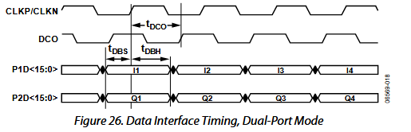   
  [Hardware Architecture Document 3.2](../hardware-architecture.md#waveform-synthesis-module) specifies DAC operation at 150MSPS, giving a CLKP/CLKN period of approximately 6.7 ns. The datasheet gives $$t_{DCO} \approx 2.2ns$$ (typical), so data is sampled approximately 4.2ns after the DCO rising edge. With $$t_{DBS} > 400 ps$$, data must settle within at most 3.8ns; additional timing margin is preferable in practice.

- **Interface signals**: List input/output signal names, levels, impedances, and timing requirements
  | Signal Name | Level | Protocol | Impedance | Connected To | Notes |
  |----------|------|------|----------|----------|----------|
  | 50MHz clock input | LVDS25 | Differential 100Ω | \ | CDCI6214 | System clock |
  | MSPI interface | 3.3V | SPI | \ | code flash | Program loading |
  | Command input | 3.3V | SPI | \ | MCU | Command input; series resistor on MISO near FPGA; label Ctrl_SPI_* in the schematic to distinguish it from DAC control SPI |
  | Analog-front-end control | 3.3V | GPIO | \ | Signal relays | Transistor current drivers |
  | Clock control | 3.3V | GPIO | \ | Signal relays | Transistor current drivers |
  | Multifunction input/output | 3.3V | GPIO | \ | Multifunction input/output | Buffered through 74AHC125 |
  | DAC data interface | 3.3V | Parallel | 50Ω (recommended) | DAC | Data-trace length mismatch < 5mil; label DAC_SPI_* in the schematic to distinguish it from command-input SPI |
  | DCO | 3.3V | \ | \ | DAC | Data clock; as short as possible |
  | DAC control | 3.3V | SPI | \ | DAC |  |
  | JTAG programming interface | 3.3V | JTAG | \ | JTAG | Add ESD protection |

- **Detailed design**:
  - LVDS clock input:
    1. Connect the LVDS input to the FPGA PLL_IN pins
    2. Length mismatch < 5mil, total length < 4000mil
    3. Differential routing with controlled 100Ω impedance;
    4. 100Ω termination resistor tolerance > 1%
  - DAC data interface:
    1. Data-trace length mismatch < 5mil
    2. Controlled 50Ω impedance on data traces
    3. Reserve series-resistor pads at the source end of data traces (initially fit 0Ω)
  - DCO data clock:
    1. Controlled 50Ω impedance
    2. As short as possible
    3. Connect to an FPGA GCLK pin

- **Test points**:
  - Multifunction input/output

### 2.2 DAC Circuit
- **Schematic screenshot**: 
- **Functional description**: Digital-to-analog conversion
- **Key components**:
  | Component | Model | Features | Selection Rationale |
  |------|-----|------|----------|
  | DAC | AD9747 | 16bit, maximum 250MSPS (reduced to 150MSPS in view of FPGA performance), dual-channel; currently only channel 1 is used | See [DAC Selection ADR](../adr/003-dac-select.md) |

- **Interface signals**: List input/output signal names, levels, impedances, and timing requirements
  | Signal Name | Level | Protocol | Impedance | Connected To | Notes |
  |----------|------|------|----------|----------|----------|
  | DAC data interface | 3.3V | Parallel | 50Ω (recommended) | FPGA | Data-trace length mismatch < 5mil |
  | DCO | 3.3V | \ | \ | FPGA | Data clock; as short as possible |
  | DAC control | 3.3V | SPI | \ | FPGA |  |
  | Clock input | LVDS25 | Differential 100Ω | \ | CDCI6214 | 150MHz clock input |
  | Main DAC output | \ | \ | 50Ω | Reconstruction filter | I/V conversion through two 49.9Ω 0.1% resistors |
  | Auxiliary DAC output | \ | \ | 50Ω | Offset-generation module | I/V conversion through two 49.9Ω 0.1% resistors |

- **Design calculations**:
According to the AD9747 datasheet:
- The main DAC maximum output current is 20mA; output voltage must not exceed 1.0V
- The auxiliary DAC maximum output current is 2mA; output voltage must not exceed 1.25V

  The I/V conversion can therefore be designed as follows:
  1. Connect each of the main DAC's two differential current-output pins to ground through a 49.9Ω resistor. The maximum output voltage is:
    $I_{max} \times R = 20mA \times 49.9\Omega = 998mV $
    This meets the specification.

- **Detailed design**:
1. Connect each of the main DAC's two differential current-output pins to ground through a 49.9Ω resistor, and each of the auxiliary DAC's two differential current-output pins to ground through a 499Ω resistor, meeting the specification.

2. The DAC clock does not support direct LVDS input. An AC-coupled conversion circuit is required to produce a differential input with approximately 400mV common-mode voltage. Base the design on the example circuit in the datasheet: 
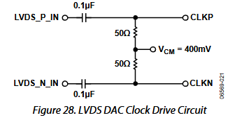

- **Test points**:
  - Offset-voltage output
  
### 2.3 Analog Front End
#### 2.3.1 Reconstruction Filter
- **Schematic screenshot**: 
  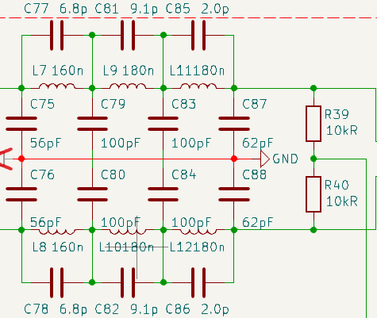
- **Functional description**:
  Remove image frequencies and high-frequency spurious components from the DAC output to meet the technical specification's in-band ripple and out-of-band rejection requirements.
  > This design prioritizes sine-wave specifications, so the filter focuses on in-band ripple and out-of-band rejection, resulting in relatively large group-delay variation. Non-sinusoidal waveforms (especially square waves) may require software predistortion to compensate for the amplitude and phase distortion introduced by the filter
- **Key components**:

  | Component | Model | Features | Selection Rationale |
  |------|-----|------|----------|
  | Inductor | AHW2012C | Ceramic-core wirewound inductor | Good high-frequency performance, suitable for filtering |
  | Capacitor | CC0603 | C0G/NP0 ceramic capacitor, tolerance > 2% | Low loss and good stability |

- **Design calculations**:
The filter is designed using Filter Solutions as follows:
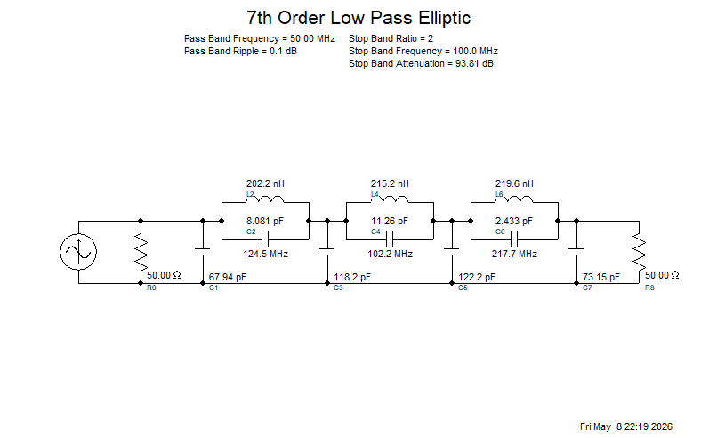
For the detailed design process, see: [Reconstruction Filter Debugging Notes](/docs/design-notes/reconstruction-filter-debugging.md)

- **Simulation results**:
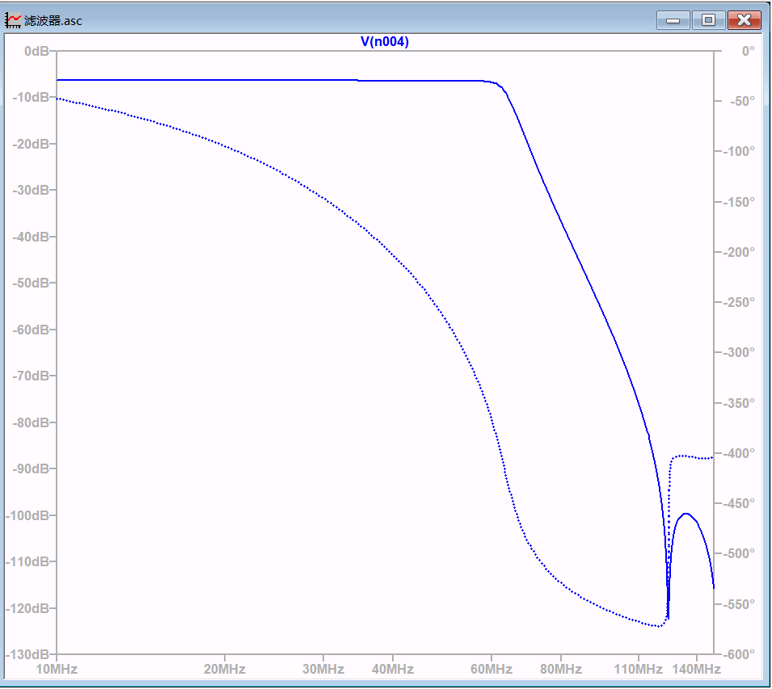
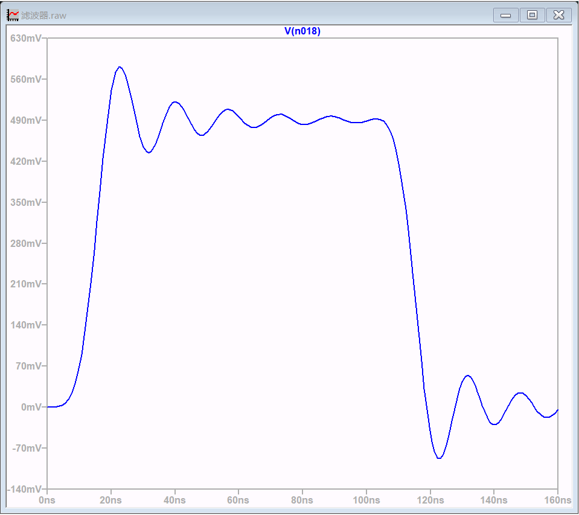

- **Interface signals**:
  
| Signal Name | Impedance | Connected To | Notes |
|----------|------|----------|------|
| Differential voltage input | 50Ω | DAC output | I/V conversion through two 49.9Ω resistors |
| Differential voltage output | 50Ω | Differential-to-single-ended module | Converted to single-ended output through OPA695 |

- **Detailed design**:
  1. 7th-order elliptic filter, 60MHz cutoff, in-band ripple < 0.5dB, rejection at 115MHz > 60dB.
  2. Input impedance 50Ω, output impedance 50Ω.
  3. Passive LC topology, using AWH2012C inductors (or other high-Q inductors) and CL10C capacitors (or other C0G/NP0 ceramic capacitors, tolerance > 5%).

- **Test points**:
  - Provide output test points for frequency-response and time-response measurements
  
#### 2.3.2 Common-Mode Feedback Circuit
- **Schematic screenshot**: 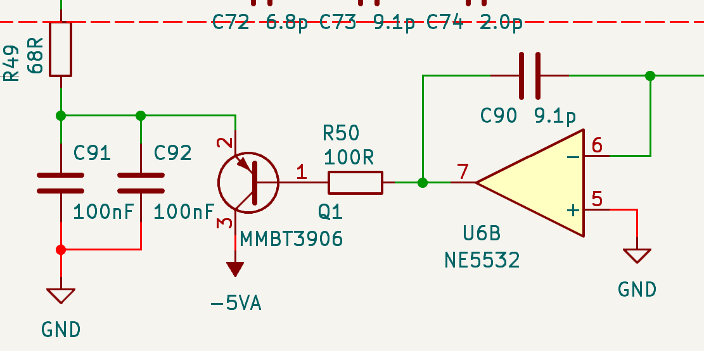
- **Functional description**:
  Stabilize the differential amplifier input common-mode voltage, prevent output-swing limitation, and ensure stable filter performance.
- **Key components**:
  
  | Component | Model | Features | Selection Rationale |
  |-----|-----|------|----------|
  | Op amp | NE5532 | Dual op amp, low noise, suitable for common-mode feedback | Low cost; performance meets common-mode feedback requirements |

#### 2.3.2 Differential-to-Single-Ended Conversion
- **Schematic screenshot**: 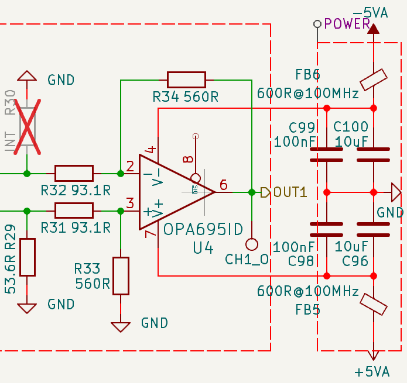
- **Functional description**: Convert the filter's differential output to a single-ended signal meeting the input requirements of the subsequent attenuation network and output amplifier stage.
- **Key components**:
  | Component | Model | Features | Selection Rationale |
  |------|-----|------|----------|
  | Op amp | OPA695 | Current-feedback op amp, low noise, high bandwidth | Meets bandwidth and noise requirements |

- **Design calculations**:
  Simulation shows approximately 6.30dB filter insertion loss (approximately 0.485V/V), and a subsequent combiner gain of approximately 0.44V/V (approximately -7.13dB). Since later stages may introduce further losses, this module is designed for a gain of 6V/V (approximately 15.56dB), leaving headroom for software adjustment.
1. Impedance-matching calculations:
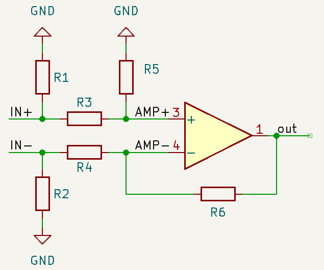
  The filter is designed for a 50Ω load, so the differential-to-single-ended circuit should have a 50Ω input impedance. With gain $G = 6 V/V$:
  $$\frac{R3}{R5} = \frac{R4}{R6} = \frac{1}{G} = \frac{1}{6}$$
  Therefore:
  $$ R5 = R6 = 6 \times R3 = 6 \times R4 $$
  
    1. Inverting input:
    Since $R5 = 6 \times R3$:
    $$V_{AMP+} = V_{IN+} \times \frac{R5}{R3 + R5} = \frac{6}{7}V_{IN+}$$
    Also, under pure differential-mode operation, $$V_{IN+} = -V_{IN-}$$, so the voltage across R4 is:
    $$V_{R4} = V_{IN-} - V_{AMP+} = -\frac{13}{7}V_{IN+}$$
    The current through R4 is:
    $$I_{R4} = \frac{V_{R4}}{R4} = -\frac{13V_{IN+}}{7R4}$$
    The input impedance at the inverting input is therefore:
    $$Z_{IN-} = \frac{V_{IN-}}{I_{R4}} = \frac{7}{13} \times R4$$
    Setting $Z_{IN-} = 50\Omega$ gives:
    $$R4 = R3 = \frac{13}{7} \times 50\Omega = 92.857 \Omega \approx 93.1 \Omega$$
    Thus:
    $$R5 = R6 = 6 \times R4 = 556.428 \Omega \approx 560 \Omega$$

    > Since the inverting input exactly matches 50Ω, R2 can be omitted. Alternatively, calculate for an impedance other than 50Ω to use more common resistor values and achieve better matching, but consider whether the extra resistor's noise and cost are worthwhile.

    > Rf here is larger than the datasheet value for 6 V/V. For a current-feedback op amp, a larger Rf affects bandwidth to some extent but improves stability; an Rf that is too small compromises stability.

    2. Non-inverting input:
    From
    $$\frac{1}{50} = \frac{1}{R_1} + \frac{1}{R_3 + R_5}$$
    it follows that:
    $$R_1 = \frac{1}{\frac{1}{50} - \frac{1}{653.1}} \approx 53.6 \Omega$$

- **Detailed design**:
  - Design for 6V/V gain, with a 560Ω feedback resistor and 93.1Ω input resistor; select other resistors from the impedance-matching calculations.
  - Use dual supplies with ferrite beads and decoupling capacitors at the power inputs to ensure stable power.
  - To simplify routing, the op amp inputs and DAC outputs in channel 1 are <b>connected with reversed polarity</b>: The OPA695 non-inverting input connects to the DAC negative output, and its inverting input connects to the DAC positive output. The op amp output connects to the attenuation-network input. Therefore, <b>channel 1 data must be inverted in software</b>.
- **Simulation results**:
  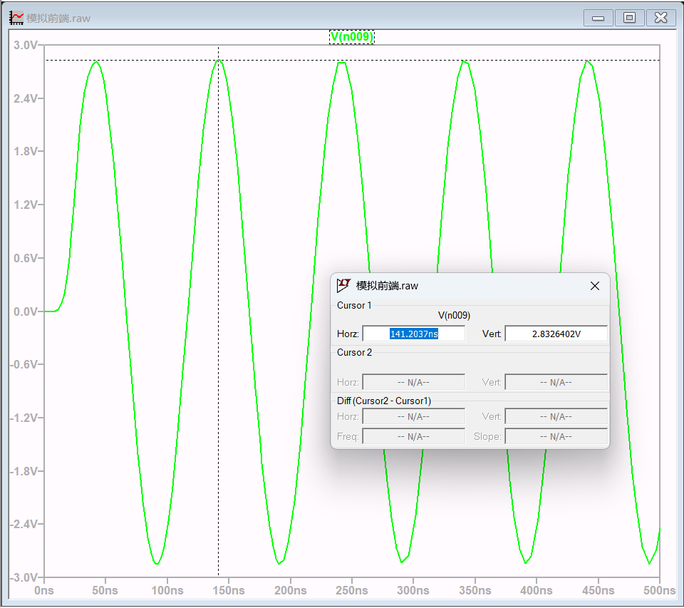
- **Protection design**:
  - A 3.0V TVS diode may be added at the waveform output to prevent externally applied voltage from entering the circuit
- **Test points**:
  - Output: Measure gain and frequency response

#### 2.3.3 Attenuation Network
- **Schematic screenshot**: To be added
- **Functional description**: What this module implements
- **Key components**: Models and selection rationale (performance, cost, availability)
- **Design calculations**:
  - Derive formulas (such as gain, cutoff frequency, output swing, power dissipation)
  - Substitute numerical values and compare with the specification
- **Simulation results** (optional): Insert LTspice/ADS waveform plots
- **Interface signals**: List input/output signal names, levels, impedances, and timing requirements
- **Protection design**: ESD, overcurrent, overvoltage, reverse polarity, etc.
- **Test points**: Recommended test points (TP_xxx) and their purposes

#### 2.3.4 Offset Generation and Summing
- **Schematic screenshot**: To be added
- **Functional description**: What this module implements
- **Key components**: Models and selection rationale (performance, cost, availability)
- **Design calculations**:
  - Derive formulas (such as gain, cutoff frequency, output swing, power dissipation)
  - Substitute numerical values and compare with the specification
- **Simulation results** (optional): Insert LTspice/ADS waveform plots
- **Interface signals**: List input/output signal names, levels, impedances, and timing requirements
- **Protection design**: ESD, overcurrent, overvoltage, reverse polarity, etc.
- **Test points**: Recommended test points (TP_xxx) and their purposes

#### 2.3.5 Output Gain Stage
- **Schematic screenshot**: To be added
- **Functional description**: What this module implements
- **Key components**: Models and selection rationale (performance, cost, availability)
- **Design calculations**:
  - Derive formulas (such as gain, cutoff frequency, output swing, power dissipation)
  - Substitute numerical values and compare with the specification
- **Simulation results** (optional): Insert LTspice/ADS waveform plots
- **Interface signals**: List input/output signal names, levels, impedances, and timing requirements
- **Protection design**: ESD, overcurrent, overvoltage, reverse polarity, etc.
- **Test points**: Recommended test points (TP_xxx) and their purposes
  <!-- Add an indicator beside the output switch to show channel status -->
-
#### 2.4 Clock Generation
- **Schematic screenshot**: 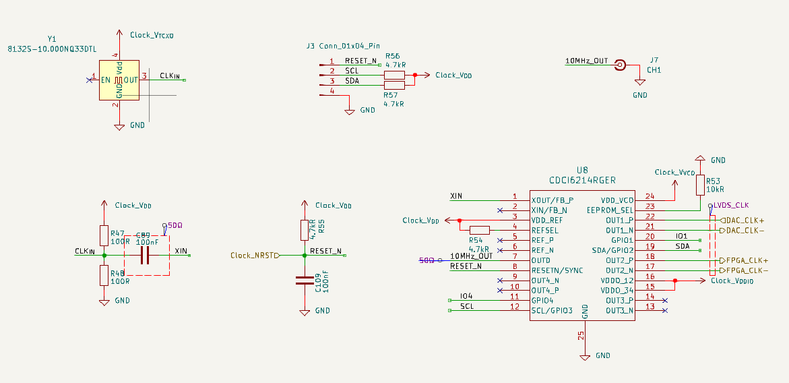
- **Functional description**:
  Generate the LVDS clock signals required by the FPGA and DAC, and a 10MHz synchronization clock output.
- **Key components**:
  
  | Component | Model | Features | Selection Rationale |
  |------|-----|------|----------|
  | Clock generator | CDCI6214 | 4 outputs, supports LVDS output | Meets clock-output requirements and supports LVDS output |
  | Oscillator | 8132S-10.000NQ33DTL | 10MHz, frequency stability ±0.5ppm, tolerance ±1ppm | Meets clock-frequency and output requirements |

- **Design calculations**:
  Configure the clock generator using the official TICS Pro software to produce the required clock frequencies and levels, ensuring that FPGA and DAC clock requirements are met.
- **Interface signals**:

  | Signal Name | Level | Protocol | Impedance | Connected To | Notes |
  |----------|------|------|----------|----------|----------|
  | External 10MHz reference clock | LVDS25 | \ | Differential 100Ω | CDCI6214 | Switch between the internal TCXO and external input with a signal relay; add TVS protection (TVS parasitic capacitance should be below 5pF) |
  | 150MHz LVDS clock output | LVDS25 | \ | Differential 100Ω | DAC |  |
  | 50MHz LVDS clock output | LVDS25 | \ | Differential 100Ω | FPGA | Clock generator output |
  | 10MHz synchronization clock output | LVCOMS33 | \ | 50Ω | Clock output connector | \ |
  | Clock control | 3.3V | GPIO | \ | FPGA | Transistor current driver controls a signal relay to switch the clock input |
  | Clock generator reset | 3.3V | GPIO | \ | FPGA, configuration header |  |
  | IIC control | 3.3V | I2C | \ | Configuration header | Configures the clock generator |

- **Protection design**:
  - Add TVS protection to the external clock input to prevent electrostatic-discharge damage to the clock generator. TVS parasitic capacitance should be below 5pF to avoid degrading clock signal quality.
  
- **Test points**:
  - 10MHz reference clock input: Measurement point for observing input signal quality
  - 10MHz synchronization clock output: Measurement point for observing clock signal quality
  > At these high clock frequencies, probing test points directly cannot provide accurate waveforms; SMA connectors or soldered wires are required. However, fitting multiple SMA connectors solely for clock-waveform measurement is not worthwhile, and wire stubs can themselves degrade clock quality. The test points are therefore intended only to confirm clock frequency, not to measure clock integrity

### 2.5 Power and Decoupling
- **Schematic screenshot**: 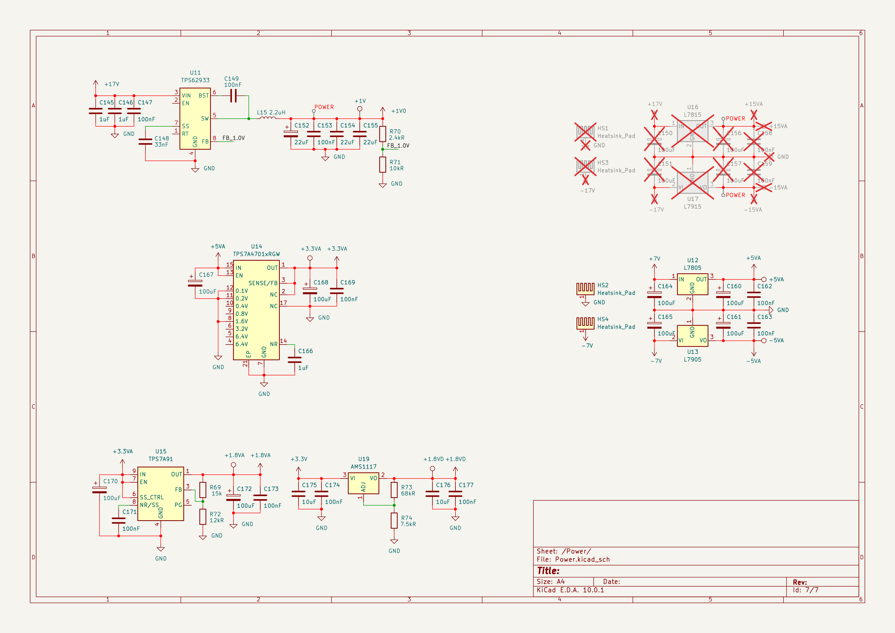
- **Functional description**:
  - Convert the ±17V input to ±15V_A, ±5V_A, +3.3V_A, +1.8V_A, and +1.0V_D rails
  - Convert the +3.3V_D input to +3.3V_A and +1.8V_D rails
- **Key components**: Models and selection rationale (performance, cost, availability)
  | Component | Model | Features | Selection Rationale |
  |------|-----|------|----------|  
  | ±15V_LDO | L7815 / L7915 | 1.2A output current, 17V input | TO-220 package, stable and reliable, low cost |
  | ±5V_LDO | L7805 / L7905 | 1.5A output current, 7V input | TO-220 package, stable and reliable, low cost |
  | 3.3V_A LDO | TPS7A4701 | 1.5A output current, 5V input, ultra-low noise | Designed for high-performance analog circuits; meets DAC and clock noise requirements |
  | 1.8V_A LDO | TPS7A9101 | 1A output current, 3.3V input, ultra-low noise | Designed for high-performance analog circuits; meets the DAC clock-supply noise requirements |
  | 1.8V_D LDO | AMS1117-ADJ | 1A output current, 3.3V input | Low cost; digital circuits have less stringent noise requirements |
  | 1.0V_D DC-DC | TPS62933 | 3A output current, 17V input, synchronous rectification, high efficiency | Synchronous rectification eliminates the freewheeling diode required for asynchronous rectification, reducing heat and size at the same current; switching-device turn-on time is only 70ns, suitable for the low duty cycle of 17 -> 1V conversion |

- **Design and calculations**:
1. **Detailed design**
  - **+1.0V_D power design**:
  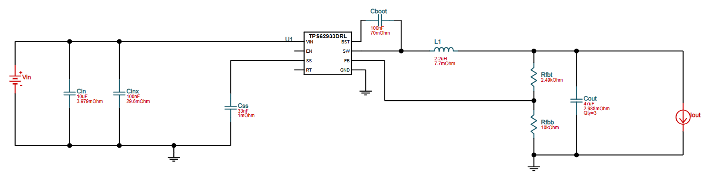

1. **Design considerations**
  - Connect the low-voltage side of each DCDC circuit (GND for a positive buck, Vout- for an inverting buck) to the corresponding copper pour through many vias to ensure a low-impedance return path
  - Minimize SW node area and keep it away from sensitive signal traces
  - Connect the thermal pad to bottom-layer copper (GND or Vout-) through many vias
  - Output capacitance may be increased moderately; large electrolytic capacitors combined with low-ESR MLCCs can ensure stability and reduce ripple
  - Increase input capacitance to reduce the effect of input ripple, paying attention to capacitor voltage ratings
   
  - LDO capacitance may be increased moderately, but watch for oscillation
  - Add an output LC filter and multiple stages of bypass capacitors to further reduce output ripple
  - Reserve space for heatsinks and fit them if needed
  - Connect each pin to large copper areas through many vias to improve current-carrying capacity and heat dissipation  <!-- Although these LDOs dissipate at most about 1W and current will not exceed 500mA, making the copper areas larger costs nothing extra -->

- **Test points**:
  - +15V_A, -15V_A rails: Voltage measurement and ripple test points
  - +5V_A, -5V_A rails: Voltage measurement and ripple test points
  - +3.3V_A rail: Voltage measurement and ripple test points
  - +1.8V_A rail: Voltage measurement and ripple test points
  - +3.3V_D rail: Voltage measurement and ripple test points
  - +1.8V_D rail: Voltage measurement and ripple test points
  - +1.0V_D rail: Voltage measurement and ripple test points
  > Remember to provide adjacent GND test points as convenient measurement references

### 2.6 Multifunction I/O
- **Schematic screenshot**: To be added
- **Functional description**: What this module implements
- **Key components**: Models and selection rationale (performance, cost, availability)
- **Design calculations**:
  - Derive formulas (such as gain, cutoff frequency, output swing, power dissipation)
  - Substitute numerical values and compare with the specification
- **Interface signals**: List input/output signal names, levels, impedances, and timing requirements
- **Protection design**: ESD, overcurrent, overvoltage, reverse polarity, etc.
- **Test points**: Recommended test points (TP_xxx) and their purposes

## 3. PCB Placement and Routing Guidelines
### 3.1 **Layer Stackup**:
- Layer count: 4
- Layer order:
  - Top: Signals + local power routing + components
  - Inner1: Continuous ground plane (GND)
  - Inner2: Split power plane (+3.3V_D, +18V_M, -18V_M, etc.)
  - Bottom: Signals + a few ground traces + auxiliary power routing
- Board material: Standard FR-4 is sufficient.
- Copper thickness: 1oz outer layers, 0.5oz inner layers.
### 3.2 Overall Placement
1. Functional partitioning (physical separation)
- High-speed digital area: FPGA, SPI Flash, DAC digital interface
- Clock area: TCXO, CDCI6214, clock buffers
- Analog area: DAC analog output, I/V conversion, filter, attenuation network, output stage
- Power area: LDOs, DC-DC converters, filtering circuits

2. Key component placement
- Place the DAC as close to the FPGA as possible, with length-matched data traces.
- Place CDCI6214 near the DAC and FPGA; prioritize short output-clock routing.
- Place the THS3095 output stage near the SMA connector and away from the digital area.

### 3.3 Routing Constraints for Key Modules
### 3.3.1 FPGA and DAC Interface
- Data traces D1[15:0]: Length-matched, with mismatch < 5mil. Space traces within the group 3 trace widths apart to avoid crosstalk.
- DAC clock trace: Route separately and keep as short as possible.
- Control signals (WRT, RESET, etc.): Strict length matching is unnecessary, but avoid glitches; 22Ω series resistors may be used.
- SPI interface: Add 22Ω resistors at the driver end to avoid reflections and glitches.

### 3.3.2 Clock Circuit
- TCXO output: Through a relay to the CDCI6214 input; keep traces short and away from digital signals.
- External 10MHz input: From SMA through ESD protection, then the relay, then CDCI6214. Maintain 50Ω characteristic impedance.
- CDCI6214 outputs:
  - 150MHz to DAC: Differential routing, controlled 100Ω impedance, length < 4000mil, intra-pair mismatch < 5mil. Add a 100Ω termination resistor at the end of the pair.
  - 50MHz to FPGA: Differential routing, controlled 100Ω impedance, length < 4000mil, intra-pair mismatch < 5mil. Add a 100Ω termination resistor at the end of the pair.
  - Maintain a continuous ground plane beneath all clock traces; do not cross power-plane splits.

### 3.3.2 DAC Circuit
- Add series ferrite beads at the power inputs and multiple parallel decoupling capacitors near the DAC pins, minimizing loop length.
- Route from DAC outputs to I/V conversion resistors as length-matched differential traces with controlled 50Ω impedance.
- Keep DAC clock input traces short, with controlled 50Ω impedance, away from digital signal traces.

### 3.3.3 Analog Signal Chain (I/V → Filter → Differential-to-Single-Ended → Attenuation → Output Stage)
1. I/V conversion
- Route from DAC outputs to I/V conversion resistors as length-matched differential traces with controlled 50Ω impedance.
- Place resistors near the filter.

2. Reconstruction filter (5th-order elliptic)
- Arrange inductors and capacitors in a T configuration with close component spacing.
- Maintain a 50Ω environment at input and output; add matching resistors if needed.

3. Differential-to-single-ended conversion
- Place feedback resistor Rf immediately adjacent to the op amp's inverting input pin to avoid parasitic inductance.
- Keep output routing as short as possible, directly into the next stage.
- Place decoupling capacitors close to the supply pins and add a ferrite bead on each rail (such as 120Ω @ 100MHz) for isolation.
- Remove copper around/beneath feedback traces to reduce parasitic capacitance.
- To simplify routing, the op amp inputs and DAC outputs in channel 1 are **connected with reversed polarity**: The OPA695 non-inverting input connects to the DAC negative output, and its inverting input connects to the DAC positive output.

4. Attenuation network (relays + resistors)
- Keep relay-control signals away from analog signal traces.
- Use 0603 surface-mount resistors with 0.1% tolerance.

5. Output stage (THS3095)
- Place input resistor Rg immediately adjacent to the non-inverting input.
- Connect the output through a 50Ω series resistor to the output relay.
- Place decoupling capacitors close to the supply pins and add a ferrite bead on each rail (such as 120Ω @ 100MHz) for isolation.
- Remove copper around/beneath feedback traces to reduce parasitic capacitance.
- Thermal management: Large bottom copper area, solder-mask openings, and a via array.

### 3.3.4 Offset Generation
- As a low-frequency circuit (< 100kHz), placement requirements are modest, but keep it away from heat sources and high-speed digital traces.
- Keep the output connection to the summer as short as possible; an RC low-pass filter (1kΩ+1μF) may be added to remove DAC glitches.

### 3.4 Power and Ground-Plane Design
- Ground planes:
  - Do not pour top-layer ground in the analog/digital sections; pour ground in the power section.
  - Use a continuous, unsplit ground plane on layer 2, without separating analog and digital grounds. All signal returns share the same reference plane to avoid enlarged loops.
  - Pour bottom-layer copper, which can serve as a heat-spreading layer.
  - Add stitching vias in open areas.
- Power plane: Divide into multiple islands. Add capacitance between each island and the ground plane (at the source).
- No routing across islands: No signal trace may cross between different regions. Ensure high-speed/precision signal traces reference continuous ground underneath rather than a power plane.
- Thermal management: Add large copper areas beneath high-dissipation devices such as power modules and output stages, connected by vias to the inner ground plane for better heat dissipation. Reserve heatsink mounting space for L78/79xx series linear regulators.

### 3.5 Thermal Management
- Connect all devices with exposed bottom thermal pads to bottom-layer copper using via arrays (with solder-mask openings as appropriate). A heatsink may be fitted to the FPGA.
  
### 3.6 PCB Manufacturing Optimization
  - Trace width: Power traces > 10mil; signal traces **without impedance requirements** > 5mil.
  - Vias: > 12/24 mil
  - Add balancing copper in large open areas (grounded through stitching vias) to prevent PCB warping.
  
### 3.7 Signal-Integrity Checklist
  - DAC data-trace length mismatch < 5mil.
  - Clock trace length < 4000mil, length mismatch < 5mil.
  - No digital signals crossing beneath any analog signals.
  - Power trace width > 10mil.
  - Every supply pin has a 0.1μF capacitor; power entry has 10~100μF capacitance.
  - No signal traces cross power-plane splits.
  - Add ground vias beneath SMA outputs and fit ESD devices.

## 4. Bring-Up and Test Plan
### 4.1 Pre-Power-Up Checklist (Short-Circuit Tests, Supply-Voltage Measurements)
Power-to-ground shorts, polarity, and soldering.
### 4.2 Standalone Board Test Procedure:
Power up in stages: Populate the power section first and verify each rail; then populate the clock circuit and measure 150MHz; next populate the FPGA and program the code; finally populate the DAC and analog front end.
Key waveform test points:
  - Supply ripple
  - SPI signal (clock, data) waveforms
  - DAC differential outputs (before the filter)
  - Filter output
  - Differential-to-single-ended output
  - Attenuator output
  - Offset voltage
  - Final output
Module tests:
  - Clock output: Measure the 150MHz waveform and jitter with an oscilloscope (using persistence mode).
  - DAC static test: Have the FPGA output a fixed code and measure DAC output current with a multimeter.
  - Filter response: Sweep S21 using a nanoVNA network analyzer (or signal generator + oscilloscope).
  - Full-chain test: Have the FPGA generate a 1MHz sine wave and observe output amplitude and distortion.
  - Performance verification: Follow the test methods in the technical specification.

## 5. Bill of Materials (BOM Summary)
- List only critical/error-prone components (resistance/capacitance/inductance values, tolerances, packages, voltage ratings, temperature coefficients)
- Save the complete BOM as a separate CSV file and link it here

## 6. Simulation Files and References
LTspice simulation circuits and Filter Solutions design files.

Page-number index for key datasheets.

## 7. Revision History
| Version | Date | Changes | Author |
|------|------|----------|--------|
| V1.0 | 2026-04-24 | Initial version | EERNINUO |
| v1.1 | 2026-05-22 | Analog-board MVP | EERNINUO |
| v1.2 | 2026-05-26 | Revised power pin assignment and moved ±7V generation to the control board| EERNINUO |