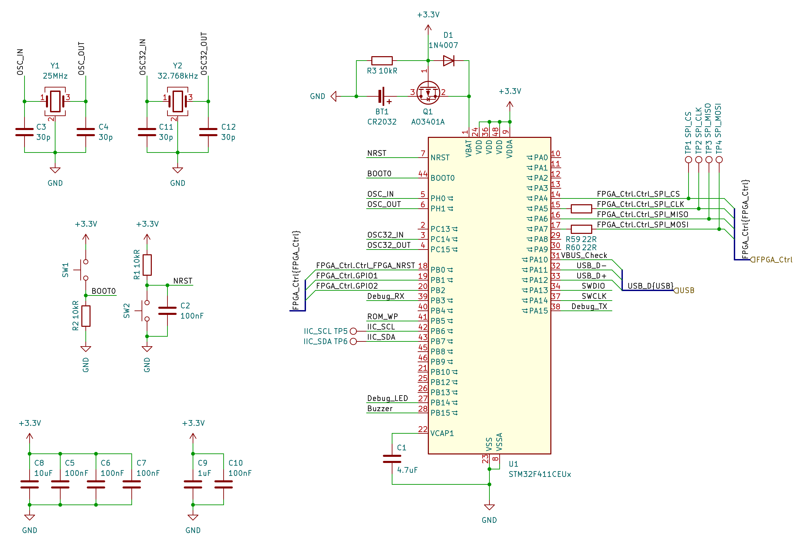
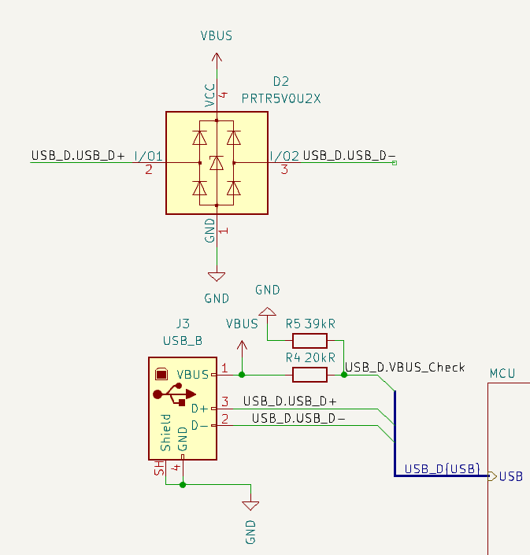
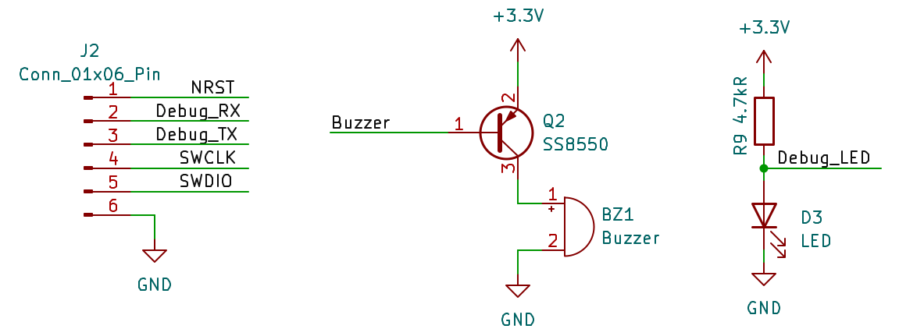
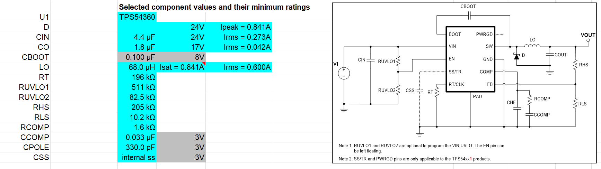
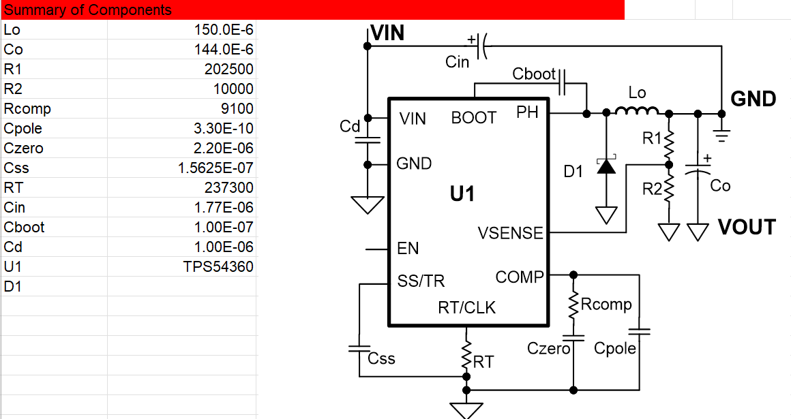
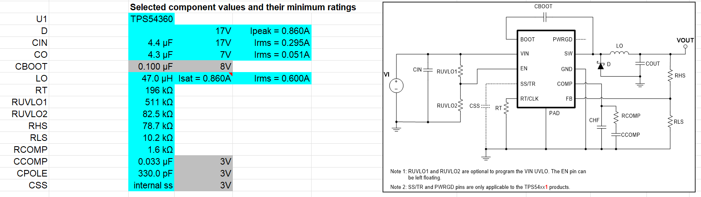
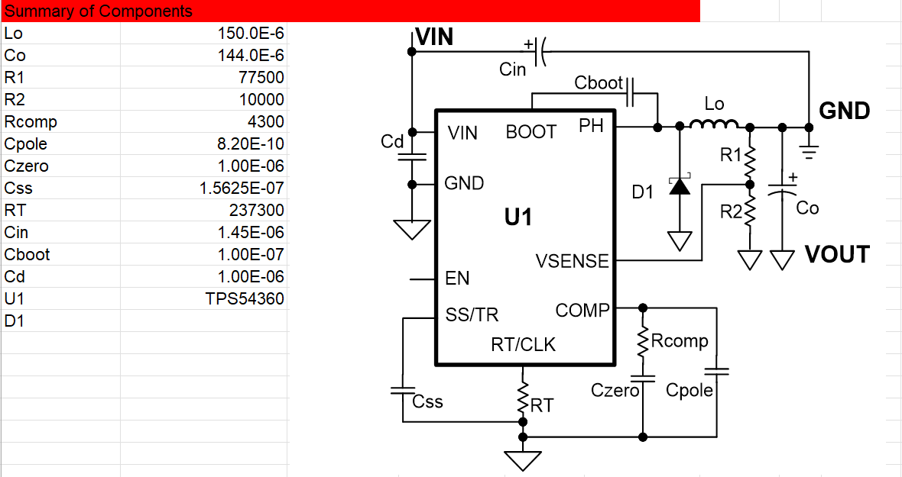

<!------------------------------------------------------------------------
SPDX-License-Identifier: CC-BY-SA-4.0
Copyright (C) 2026 [EERNINUO]

This work is licensed under the Creative Commons Attribution-ShareAlike 4.0 International License. 
To view a copy of this license, visit http://creativecommons.org/licenses/by-sa/4.0/.
------------------------------------------------------------------------->

<!-- Assisted-by: DeepSeek - Document framework -->

# ArbWave30 – Control-Board Hardware Design Document

| Document ID | ArbWave30-HDD-002 | Version | V1.1  |
| --------| ----------------- | ---- | ----- |
| Project Name | ArbWave30 | Date | 2026-05-26 |
| Author   | EERNINUO | Status | In design |

## 1. Board Overview
- Purpose: Control waveform generation on the analog board, communicate with a PC over USB, condition the input power for the analog board, and provide user interaction.
- Key performance specifications: Power consumption, dimensions, environmental requirements
  - Power consumption: < 5W (excluding power supplied to the analog board)
  - Dimensions: < 100mm x 100mm
  - Environmental requirements: 0 \~ 40 ℃
- Main interfaces:
  - External connectors:
    - Power input: DC2.1mm
    - USB interface: USB Type-B
  - Inter-board interface: See the [Inter-Board Interface Document](./inter-board-interface.md)

## 2. Detailed Module Design
### 2.1 MCU Minimum System
- **Schematic screenshot**: 
  
- **Functional description**:
  The core of the control board handles USB communication, parses SCPI commands, controls FPGA configuration, manages the user interface (buttons/encoder), and stores user settings.
- **Key components**:
  
| Component | Model | Features | Selection Rationale |
|------|-----|------|---------|
| MCU | STM32F411CEU6 | ARM Cortex-M4F, 512KB Flash, 128KB RAM | Meets performance requirements at a reasonable cost |

- **Detailed design**:
  - Power:
    - VDD: 3.3V; one separate 10uF capacitor + one 100 nF ceramic capacitor near each individual VDD pin, placed close to the chip
    - VDDA: 3.3V; a separate 1uF capacitor + 100 nF ceramic capacitor nearby, placed close to the chip <!-- Is the PLL powered from this supply? -->
    - VBAT: 3.0V; connected to a CR2032 battery holder to power the real-time clock and backup registers. A power-switching circuit automatically switches to the battery when main power is lost, preserving RTC and backup-register data.
    - VCAP: Connected to a nearby 4.7uF ceramic capacitor to stabilize the internal LDO regulator voltage.
    - VSSA/GND: Connected to the ground plane through thermal-relief pads to ensure good grounding
  - Clocks:
    - HSE: External 8MHz crystal, as close to the MCU as possible; the internal PLL generates a 96MHz system clock. Select load capacitors according to the datasheet.
    - LSE: External 32.768kHz crystal provides the RTC clock source. Select load capacitors according to the datasheet.
  - Reset: Connect the reset pin to the debug header for debugger control, to ground through a 100nF capacitor, and to VDD through a 10kΩ pull-up resistor (the datasheet specifies an internal NRST pull-up of approximately 40kΩ, but it may be unreliable in a noisy environment, so retain external pull-up pads and adjust as needed).
  - Debug interface: A 7-pin 2.54mm header combines SWD and the debug serial port (USART1) for debugging and programming.
  - Boot configuration: Boot0 is pulled down to ground through 10kΩ by default. For programming in bootloader mode, use a button to short BOOT0 to 3.3V.
  - SPI1: Connected to the inter-board connector for FPGA control. Place 22Ω series resistors on MOSI/CLK near the MCU; no series resistor on MISO.

- **Interface signals**: List input/output signal names, levels, impedances, and timing requirements
  | Signal Name | Direction | Protocol | Connected To | Notes |
  |--------|------|------|--------|------|
  | SWDIO/SWCLK | Bidirectional | SWD | Debugger (ST-Link) | Debugging and programming |
  | USB DP/DM | Bidirectional | USB 2.0 FS | USB connector | Differential signals, 90Ω impedance |
  | SPI1 | Bidirectional | SPI | FPGA configuration | 22Ω series resistors on MOSI/CLK near the MCU |
  | GPIO | Output | GPIO | Buzzer | Transistor current driver |
  | IIC | Bidirectional | IIC | EEPROM | 100kHz |
  | UART | Bidirectional | UART | Debug serial port | 115200 baud rate |
  
- **Protection design**:
  - SPI1 interface: Place 22Ω series resistors on MOSI/CLK near the MCU, with no series resistor on MISO. Design the pads to accept 0Ω resistors or direct solder bridges.
  - USB interface: See the [USB Interface](#usb-interface) section.
  
- **Test points**:
  - SPI1_SCK/MOSI/MISO/CS: Observe SPI signal quality and timing with an oscilloscope.
  - IIC_SDA/SCL: Observe I2C communication waveforms

### 2.2 USB Interface
 - **Schematic screenshot**: 
- **Functional description**:
  - Receive SCPI commands over USB-FS
  - Send response data over USB-FS
  - Automatically detect cable insertion
- **Key components**:

| Component | Model | Features | Selection Rationale |
|------|-----|------|---------|
| USB connector | USB Type-B | 4-wire USB2.0 receptacle | Stable connection, high reliability, industry standard |
| ESD device | PRTR5V0U2X | Ultra-low-capacitance dual rail-to-rail ESD device | Protects the USB interface |

- **Interface signals**:
  | Signal Name | Direction | Protocol | Connected To | Notes |
  |--------|------|------|--------|------|
  | USB_DP/DM | Bidirectional | USB 2.0 FS | PC | CDC |
  | VBUS | Input | Logic level | MCU GPIO | USB connection detection |

- **Detailed design**:
  - Route USB DP/DM as a length-matched differential pair with controlled 90Ω impedance. Avoid vias and place the ESD protection device near the connector.
  - USB 22Ω series resistors can reduce reflections and EMI, but ST does not recommend adding them. Retain pads near the MCU, but fit 0Ω resistors or short them directly.
  - Connect GND directly to the board ground plane.
  - Connect the connector shell to ground through thermal-relief pads for additional shielding and grounding paths.
  - Divide VBUS down to 3.3V with resistors before connecting it to an MCU GPIO for USB connection detection.
  - The MCU implements the DP pull-up internally; no external 1.5k resistor is required, only software configuration.

- **Protection design**: ESD, overcurrent, overvoltage, reverse polarity, etc.
  - ESD protection: USBLC6-4SC6Y automotive-grade low-capacitance device protects USB DP/DM against electrostatic-discharge damage.
  - Overcurrent protection: USB VBUS is used only for detection, not as a direct power source, avoiding overcurrent risk.
  - Reverse-connection protection: The USB connector is inherently polarized; no additional reverse-connection protection is required internally.
  
- **Test points**:
  - TP_USB_DP/DM: Observe USB signal quality and timing with an oscilloscope.
  - TP_USB_VBUS: Measure the USB connection-detection voltage and verify detection functionality.

### 2.3 EEPROM
- **Schematic screenshot**: 
- **Functional description**: Store calibration coefficients and user settings
- **Key components**: EEPROM: M24C64 (64Kb, I2C interface), for storing calibration coefficients and user settings.
- **Interface signals**:
  - I2C_SDA/SCL: EEPROM connection, standard mode at 100kHz
  - WP: Write-protect pin connected to an MCU GPIO for software-controlled write protection.

### 2.4 Human-Machine Interface (Implemented in v3.0)
> v1.0 and v2.0 support only SCPI remote control; v3.0 supports local operation
- **Schematic screenshot**: To be added
- **Functional description**: Provide human-machine interaction
- **Key components**:

| Component | Model | Features | Selection Rationale |
|------|-----|------|----------| 
| Display | 3.5-inch TFT | MIPI interface, 1024x768 resolution | Easy to drive |
| Encoder | EC11-01 | 360-degree rotation with push button | Simplifies the front panel |

- **Detailed design**:
  - The display interface uses MIPI output; route length-matched differential pairs and avoid vias.
  <!-- MIPI routing details to be added -->
  - Detect encoder rotation through the timer's encoder interface and button presses through GPIO interrupts, using internal pull-ups.
  - Arrange buttons as a matrix keypad and scan key states by rows and columns.
  
- **Interface signals**:
  
| Signal Name | Direction | Protocol | Connected To | Notes |
|--------|------|------|--------|------|
| TFT_MIPI | Output | MIPI | TFT | \ |
| ENCODER_A/B/C | Input | Button/encoder | Encoder | \ |
| Buttons | Input | Buttons | Button inputs | Matrix keypad |
- **Test points**:
  - TP_TFT_MIPI: Observe TFT display signal quality with an oscilloscope.
  - TP_ENCODER_A/B/C: Observe encoder/button signal quality with an oscilloscope.
  
### 2.5 Debug Interface
- **Schematic screenshot**: 
- **Functional description**: Connect the debugger and debug serial port, and program firmware
- **Key components**:
  
  | Component | Model | Features | Selection Rationale |
  |------|-----|------|----------|
  | 6Pin header | 6Pin header | Pin header | \ |
  | Buzzer | Passive buzzer | Passive buzzer | \ |

- **Interface signals**:
  
  | Signal Name | Direction | Protocol | Connected To | Notes |
  |-------|------|------|--------|------|
  | SWD | Bidirectional | SWD | Debugger (ST-Link) | Debugging and programming |
  | UART | Bidirectional | UART | Debug output | 115200 baud rate |
  | GPIO | Output | GPIO | Buzzer | Transistor current driver |
  |      |     |      | LED | \ |
  
- **Detailed design**:
  - Debug interface pin assignment:
  
  | 1 | 2 | 3 | 4 | 5 | 6 |
  |---|---|---|---|---|---|
  | GND | NRST | RX | TX | SWCLK | SWDIO |
  > Label pin functions on the PCB silkscreen
  - Drive the buzzer from the GPIO through a PNP transistor current driver

### 2.6 Power Input and Protection
- **Schematic screenshot** (or link)
- **Functional description**:
  - Convert the 24V input to ±17V_M and 3.3V_D rails, supplying stable power to the control and analog boards
  - Overcurrent, overvoltage, and reverse-polarity protection

- **Key components**:

  | Component | Model | Features | Selection Rationale |
  |------|-----|------|----------|
  | Power input connector | DC2.1mm | 2.1mm DC power jack | Industry standard, stable connection, inherently prevents reverse connection |
  | TVS diode | SMBJ24A | 24V reverse standoff voltage, 38.9V clamping voltage, unidirectional, SMB package | Protects the power input from overvoltage transients |
  | +17V_M DC-DC | TPS54360 | 3A output current, 24V input, high efficiency | Main power rail; higher efficiency reduces heat |
  | -17V_M DC-DC | TPS54360_inverting buck | 3A output current, 24V input, high efficiency |  |
  | +7V_M DC-DC | TPS54360 | 3A output current, 17V input, high efficiency | Main power rail; higher efficiency reduces heat |
  | -7V_M DC-DC | TPS54360_inverting buck | 3A output current, 17V input, high efficiency |  |
  | +3.3V_D DC-DC | TPS54360 | 3A output current, 24V input | Digital power rail; higher efficiency reduces heat |

- **Design calculations**:
1. **Detailed design**
  - **+17V_M power design**:
  
   

  - **-17V_M power design**:
  
   

  - **+7V_M power design**:
  
   

  - **-7V_M power design**:
  
   

2. **Design considerations**
  - Connect the low-voltage side of each DCDC circuit (GND for a positive buck, Vout- for an inverting buck) to the corresponding copper pour through many vias to ensure a low-impedance return path
  - Minimize SW node area and keep it away from sensitive signal traces
  - Connect the thermal pad to bottom-layer copper (GND or Vout-) through many vias
  - Output capacitance may be increased moderately; large electrolytic capacitors combined with low-ESR MLCCs can ensure stability and reduce ripple
  - Increase input capacitance to reduce the effect of input ripple, paying attention to capacitor voltage ratings

- **Protection design**: ESD, overcurrent, overvoltage, reverse polarity, etc.
- **Test points**:
  - +17V, -17V rails: Voltage measurement and ripple test points
  - +7V, -7V rails: Voltage measurement and ripple test points
  - 3.3V_D rail: Voltage measurement point

## 3. PCB Placement and Routing Guidelines
### 3.1 Layer Stackup
  - Layer count: 4
  - Layer order:
    - Top: Signals + local power routing + components
    - Inner1: Continuous ground plane (GND)
    - Inner2: Split power plane (+3.3V_D, +18V_M, -18V_M, etc.)
    - Bottom: Signals + a few ground traces + auxiliary power routing
  - Thickness: 1.6mm total; calculate trace width for 50Ω single-ended routing (for example, 0.25mm trace width referenced to a ground plane).
  - Copper thickness: 1oz (35μm) on inner and outer layers.

### 3.2 Overall Placement Principles
1. Partition by function
  - Power input area (DC jack, TVS, reverse-polarity protection, DC-DC)
  - MCU area (STM32, crystal, SWD, USB)
  - Connector area (headers to analog board, trigger SMA)
  - Reserved expansion area (buttons, TFT header)

2. Power path
  - DC input → fuse/TVS → reverse-polarity protection → bulk capacitor (100μF) → DC-DC input.
  - Place the DC-DC output capacitor immediately adjacent to the inductor output.
  - Route power through the capacitor connection before reaching the load.

3. Thermal management
  - Place thermal vias beneath DC-DC ICs, with top-layer copper and solder-mask openings.
  - Do not route sensitive signal traces beneath inductors.

4. Interface locations
  - Place the USB connector at the board edge for easy insertion/removal.
  - Group connectors to the analog board and ensure header spacing matches.
  - Place the SMA trigger port at the board edge, away from DC-DC converters.

### 3.3 Routing Constraints for Key Modules

| Module | Constraint | Description |
|------|------|------|
| USB (DP/DM) | 90Ω differential impedance; calculate trace width/spacing from the stackup; length mismatch < 1mm; keep away from DC-DC converters and clocks |  |
| SWD debug port | Near MCU; 22Ω series resistor on CLK; avoid long traces | Facilitates programming |
| Crystal (8MHz) | < 5mm from MCU OSC_IN/OUT; ground guarding; no signal traces underneath; grounded case | Reduces radiation |
| DC-DC switching node | Traces as short and wide as possible; avoid excessive SW copper area; feedback resistors immediately adjacent to FB pin | Reduces EMI |
| Inter-board connector signals | Parallel SPI, I2C, and reset traces must be spaced > 3 trace widths apart; continuous ground reference underneath | Prevents crosstalk |

### 3.4 Ground-Plane Design
- Single-point grounding for the entire digital board: Connect all grounds directly to the uninterrupted Inner1 ground plane through vias.
- Join DC-DC power ground (PGND) and signal ground (AGND) at a single point beneath the chip (through a 0Ω resistor or direct copper connection).
- Allocate at least 30% of connector pins to GND, distributed throughout the connector.

### 3.5 Power Integrity
  - Each IC supply pin: One 0.1μF + one 1μF capacitor, preferably on the same side and immediately adjacent to the pin.
  - Place 10μF and 0.1μF capacitors near the inter-board connector to provide a clean power entry for the analog board.
  - Use split power planes: Route +3.3V_D over a large inner-layer area, and +18V_M and -18V_M on wide top- or bottom-layer traces (> 1.5mm).

### 3.6 Design for Testability
  - Provide test points: +18V_M, -18V_M, +3.3V_D, GND, SPI_CLK, SPI_MOSI, and key connector signals.
  - Test-point format: Circular exposed-copper pads, 1mm in diameter, with vias for mechanical reinforcement.

### 3.7 Routing Checklist (Self-Review)
  - Sufficient capacitance at every power input.
  - Crystal load-capacitor traces as short as possible, without unnecessary branches.
  - No switching-supply inductors near USB differential traces.
  - No long, parallel sensitive traces near connectors.
  - DC-DC output ripple within expectations (measured with an oscilloscope).

## 4. Testing and Debugging
### 4.1 Test-Point Locations
Provide test points on all supply rails and key signal traces (such as the SPI bus and USB DP/DM)
### 4.2 Pre-Power-Up Checklist (Short-Circuit Tests, Supply-Voltage Measurements)
### 4.3 Standalone Board Test Procedure:
Power up in stages: Populate the power section first and verify each rail; then populate the STM32 and program the code; next populate peripherals and verify USB, EEPROM, etc.; finally populate the connectors and test communication with the analog board.
Key waveform test points:
  - USB DP/DM waveforms (oscilloscope observation)
  - SPI signal (clock, data) waveforms
Module tests:
  - Power tests (no-load and loaded ripple)
  - Digital communication loopback tests (SPI, I2C)
  - Analog-channel static tests (fixed DAC output code, voltage measurement)
  - Dynamic tests (observe waveforms with an oscilloscope)
- Common troubleshooting guide

## 5. Bill of Materials (BOM Summary)
- List only critical/error-prone components (resistance/capacitance/inductance values, tolerances, packages, voltage ratings, temperature coefficients)
- Save the complete BOM as a separate CSV file and link it here

## 6. Revision History
| Version | Date | Changes | Author |
|------|------|----------|--------|
| V1.0 | 2026-04-25 | Initial version | EERNINUO |
| v1.1 | 2026-05-26 | Revised power pin assignment and moved ±7V generation to the control board| EERNINUO |
