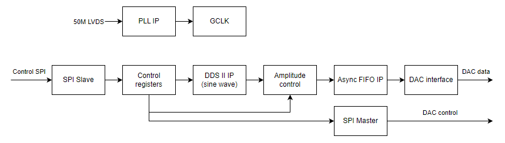
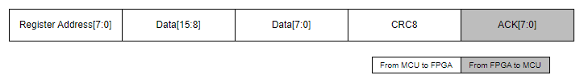

<!------------------------------------------------------------------------
SPDX-License-Identifier: CC-BY-SA-4.0
Copyright (C) 2026 [EERNINUO]

This work is licensed under the Creative Commons Attribution-ShareAlike 4.0 International License. 
To view a copy of this license, visit http://creativecommons.org/licenses/by-sa/4.0/.
------------------------------------------------------------------------->

<!-- Assisted-by: DeepSeek - document framework -->

# ArbWave30 - Software Design

| Document ID | ArbWave30-SDD-001 | Version | V1.0 |
| --------| ----------------- | ---- | ----- |
| Project | ArbWave30 | Date | 2026-04-24 |
| Author | EERNINUO | Status | In design |

## 1. Overview
### 1.1 Purpose
This document provides detailed guidance for the ArbWave30 software implementation, defining:
- Software modules, interfaces, and internal logic.
- Implementation approaches for key algorithms (such as DDS and SCPI parsing).
- Task scheduling and measures to guarantee real-time behavior.
- Frame formats and timing requirements for communication protocols (SPI, USB).

### 1.2 References

| Document | Version | Description |
|---------|------|------|
| Project Technical Specification | V1.2 | Source of functional requirements and performance specifications |
| Hardware Architecture | V1.5 | Hardware modules and interface definitions |
| AD9747 datasheet | Rev.0 | DAC timing and SPI control details |
| GW2AR datasheet | V1.0 | FPGA IO constraints and PLL configuration |

### 1.3 Software Architecture Overview
- Software components:
  - MCU firmware (STM32F411): SCPI parsing, USB communication, FPGA configuration, UI handling (buttons/encoder), nonvolatile storage.
  - FPGA logic (Verilog): DDS engine, waveform memory, parallel-interface timing, SPI slave interface.
  - Host test scripts (Python + PyVISA, optional).
- Development environment:
  - MCU: Keil (MCU).
  - FPGA: GOWIN IDE.
  - Test scripts: Python 3.12.

## 2. Software Architecture


## 3. Inter-Board Communication Protocol (MCU ↔ FPGA)
### 3.1 Physical Layer

| Parameter | Specification | Notes |
|------|------|------|
| Interface | SPI | 4-wire (CS, SCK, MOSI, MISO) |
| Operating mode | Mode 0 | CPOL=0, CPHA=0 (SCK idle low, sample on rising edge) |
| Maximum clock frequency | 10 MHz | Limited by the inter-board connector cable length |
| Bit order | MSB First | Most significant bit first within each byte |
| Byte order | Little-Endian | Least significant byte first for multibyte values (native STM32 order) |
| Logic level | 3.3V LVCMOS | Matches FPGA bank voltage |

> **Hardware connections**: See [Inter-Board Interface Design, Section 3.2, Signal Connector (J_SIG)](/docs/hardware-design/inter-board-interface.md#signal-connector-j-sig) for pin definitions.

### 3.2 Protocol Frame Format
Address (1 Byte) -> Data (2 Bytes) -> CRC8 -> ACK (1 Byte)



#### 3.2.1 Address Byte

| Bit | Function | Notes |
|-----|------|------|
| bit7 | R/W# | 0 = write (MCU → FPGA), 1 = read (FPGA → MCU) |
| bit6\~0 | Register address | Register address (0~127); see the register map in Section 3.3 |

#### 3.2.2 Data
All registers are 16 bits wide. Multibyte transfers use little-endian order:
- The least significant byte (LSB) appears first on MOSI.
- The most significant byte (MSB) appears last.

Example: writing 0x1234 to address 0x00 produces this MOSI byte sequence:
```text
[0x00]   [0x34][0x12]   [CRC_H]
Address Data (little-endian) CRC16
```

#### 3.2.3 CRC8 Check
Algorithm: CRC-8  
Polynomial: 0x07 ($X^8 + X^2 + X^1 + 1$)  
Initial value: 0x00  
Coverage: from the address byte through the last data byte, excluding CRC and ACK.

#### 3.2.4 ACK Byte

| Bit | Function | Notes |
|-----|------|------|
| bit7~4 | - | Reserved (default 0) |
| bit3 | CRC_ERR | CRC error; fixed at 0 for reads |
| bit2 | BUSY | FPGA busy |
| bit1 | ADDR_ERR | Register address error |
| bit0 | ACK | Acknowledgment flag; 1 if and only if bit7~bit1 are all 0 |

```verilog
  bit0 = ~( | bit[7:1] )
```

### 3.3 Register Map
The register map uses absolute addressing, dividing the address space into three functional regions to decouple channel control from global control.
All registers are 16 bits wide. Reserved bits must be written as 0.

#### 3.3.1 Register Types

| Type | Description | Notes |
|------|------|------|
| R | Read-only | Cannot be written |
| RW | Read/write | Readable and writable |
| RWC | Read-to-clear | Automatically cleared after a read |
| WS | Self-clearing | Automatically cleared after the operation completes |
| W1C | Write-one-to-clear | Writing 1 clears the corresponding bit; not readable |

#### 3.3.2 Register Map Summary
Region A: system/global registers (addresses 0x00 ~ 0x0F)

| Address | Name | Type | Default | Description |
|------|------|-----|-------|------|
| 0x00 | SYS_ID_L | R | 0x4257 | Device identifier; always returns 0x4257 (ASCII "BW") |
| 0x01 | SYS_ID_H | R | 0x4152 | Device identifier; always returns 0x4152 (ASCII "AR") |
| 0x02 | SYS_CTRL | Mixed | | System control (clock source, soft reset, etc.) |
| 0x03 | SYS_STATUS | R | | System status (PLL lock, temperature alarm, etc.) |
| 0x04 ~ 0x0F | Reserved | - | 0x00 | - |

Region B: channel 1 registers (addresses 0x10 ~ 0x1F)

| Address | Name | Type | Default | Description |
|------|------|-----|-------|------|
| 0x10 | CH1_CTRL | WR | | Channel 1 control (waveform selection, output enable, etc.) |
| 0x11 | CH1_FREQ_L | RW | 0x00 | Channel 1 frequency control word, low 16 bits |
| 0x12 | CH1_FREQ_M | RW | 0x00 | Channel 1 frequency control word, middle 16 bits |
| 0x13 | CH1_FREQ_H | RW | 0x00 | Channel 1 frequency control word, high 16 bits |
| 0x14 | CH1_AMPL | RW | 0x00 | Channel 1 amplitude control word, int16 |
| 0x15 | CH1_OFFSET | RW | 0x00 | Channel 1 offset control word, int16 |
| 0x16 | CH1_PHASE | RW | 0x00 | Channel 1 phase control word, uint16 |
| 0x17 | CH1_DUTY | RW | 0x7FFF | Channel 1 duty-cycle (square)/symmetry (triangle) control word, uint16 |
| 0x18 | CH1_SLOPE_UP_L | R | 0x00 | Channel 1 rising-edge slope, low 16 bits |
| 0x19 | CH1_SLOPE_UP_H | R | 0x00 | Channel 1 rising-edge slope, high 16 bits |
| 0x1A | CH1_SLOPE_DOWN_L | R | 0x00 | Channel 1 falling-edge slope, low 16 bits |
| 0x1B | CH1_SLOPE_DOWN_H | R | 0x00 | Channel 1 falling-edge slope, high 16 bits |
| 0x1C ~ 0x1F | Reserved | - | 0x00 | - |

Region C: channel 2 registers (addresses 0x20 ~ 0x2F)

| Address | Name | Type | Default | Description |
|------|------|-----|-------|------|
| 0x20 | CH2_CTRL | WR | | Channel 2 control (waveform selection, output enable, etc.) |
| 0x21 | CH2_FREQ_L | RW | 0x00 | Channel 2 frequency control word, low 16 bits |
| 0x22 | CH2_FREQ_M | RW | 0x00 | Channel 2 frequency control word, middle 16 bits |
| 0x23 | CH2_FREQ_H | RW | 0x00 | Channel 2 frequency control word, high 16 bits |
| 0x24 | CH2_AMPL | RW | 0x00 | Channel 2 amplitude control word, int16 |
| 0x25 | CH2_OFFSET | RW | 0x00 | Channel 2 offset control word, int16 |
| 0x26 | CH2_PHASE | RW | 0x00 | Channel 2 phase control word, uint16 |
| 0x27 | CH2_DUTY | RW | 07FFF | Channel 2 duty-cycle (square)/symmetry (triangle) control word, uint16 |
| 0x18 | CH2_SLOPE_UP_L | R | 0x00 | Channel 2 rising-edge slope, low 16 bits |
| 0x19 | CH2_SLOPE_UP_H | R | 0x00 | Channel 2 rising-edge slope, high 16 bits |
| 0x1A | CH2_SLOPE_DOWN_L | R | 0x00 | Channel 2 falling-edge slope, low 16 bits |
| 0x1B | CH2_SLOPE_DOWN_H | R | 0x00 | Channel 2 falling-edge slope, high 16 bits |
| 0x28 ~ 0x2F | Reserved | - | 0x00 | - |

Region D: DAC register mapping (addresses 0x30 ~ 0x3B, corresponding to DAC registers 0x00 ~ 0x12)

| Mapped address | Original address | Initial value | Name |
|---------|--------|-------|------|
| 0x30\[15:8] | 0x00 | 0x00 | SPIControl |
| 0x30\[7:0] | 0x02 | 0x00 | Data Control |
| 0x31\[15:8] | 0x03 | 0x00 | PowerDown |
| 0x31\[7:0] | 0x0A | 0x00 | DAC Mode Select |
| 0x32\[15:8] | 0x0B | 0xF9 | DAC1 Gain LSB |
| 0x32\[7:0] | 0x0C | 0x01 | DAC1 Gain MSB |
| 0x33\[15:8] | 0x0D | 0x00 | AUX DAC1 LSB |
| 0x33\[7:0] | 0x0E | 0x00 | AUX DAC1 MSB |
| 0x34\[15:8] | 0x0F | 0xF9 | DAC2 Gain LSB |
| 0x34\[7:0] | 0x10 | 0x01 | DAC2 Gain MSB |
| 0x35\[15:8] | 0x11 | 0x00 | AUX DAC2 LSB |
| 0x35\[7:0] | 0x12 | 0x00 | AUX DAC2 MSB |
| 0x36 ~ 0x3B | - | 0x00 | - |

> **The frequency/phase/amplitude/offset registers (0x10~0x16, 0x20~0x26) are all shadow registers.**
Writing these registers from the MCU **does not immediately update** the main DDS parameters inside the FPGA.
Only when the MCU writes 1 to SYS_CTRL -> UPDATE does the FPGA atomically load all shadow register values into the DDS core.

> MCU writes to 0x30~0x3B only update the FPGA's internal DAC shadow cache; they **do not trigger SPI transfers**.
> Only when the MCU writes 1 to SYS_CTRL -> DAC_CMD_WRITE does the FPGA **flush these cached values to the AD9747 in a single SPI update**.

#### 3.3.3 System Control Register SYS_CTRL (Address 0x02)

| Bit | Name | Type | Default | Description |
|------|------|-----|-------|------|
| \[15:4] | - | - | 0x00 | Reserved |
| \[3] | UPDATE | WS | 0x0 | Update main register values; cleared by hardware when complete |
| \[2] | DAC_CMD_WRITE | WS | 0x0 | Write main DAC registers; cleared by hardware when complete |
| \[1] | CLOCK_SRC | WR | 0x0 | Clock source selection: 0 = internal, 1 = external |
| \[0] | SOFT_RST | WS | 0x0 | Software reset, equivalent to pulling FPGA_NRST low (write 1 to reset, automatically cleared to 0) |

#### 3.3.4 System Status Register SYS_STATUS (Address 0x03)

| Bit | Name | Type | Default | Description |
|------|------|-----|-------|------|
| bit\[15:1] | - | - | 0x00 | Reserved |
| bit\[0] | PLL_LOCK | R | 0x0 | PLL lock status |

#### 3.3.5 Channel Control Register CHx_CTRL (Address 0x10/0x20)

| Bit | Name | Type | Default | Description |
|------|------|-----|-------|------|
| bit\[15] | CHx_ENABLE | RW | 0 | Channel enable: 0 = disabled, 1 = enabled |
| bit\[14:6] | - | - | 0x00 | Reserved |
| bit\[5:0] | WAVEFORM | RW | 0x00 | Waveform selection; see values below |

| WAVEFORM | Waveform type | Notes |
|----------|----------|------|
| 0x00 | Sine | - |
| 0x01 | Square | - |
| 0x02 | Triangle | - |
| 0x03 | Noise | - |
| 0x04 | DC | - |
| 0x05 ~ 0x3F | - | Reserved |

### 3.4 Communication Timing and Sequence
Write timing:

<!--
{
    signal: [
      {name: 'CS', wave: '10...|...|...|...|...|.1'},
      {name: 'clk', wave: '0.P..|...|...|...|...|.l'},
      {name: 'mosi',wave: '0..22|222|222|222|20.|...', data: [ 'A6', ,'A0','D7', ,'D0', 'D15', ,'D8','crc7', ,'crc0'] , phase: '0.5'},
      {name: 'miso', wave:'0....|...|...|...|.22|20.', data: ['ack7',,'ack0'], phase:'0.5'}
    ],
}
 -->

Read timing:

<!--
{
    signal: [
      {name: 'CS', wave: '10...|...|...|...|...|.1'},
      {name: 'clk', wave: '0.P..|...|...|...|...|.l'},
      {name: 'mosi',wave: '0..22|20.|...|...|...|...', data: [ 'A6', , 'A0'] , phase: '0.5'},
      {name: 'miso', wave:'0....|.22|222|222|222|20.', data: ['D7', , 'D0','D15', , 'D8', 'crc7', , 'crc0','ack7',,'ack0'], phase:'0.5'}
    ],
}
 -->

> **Data received while CS is low is treated as one frame.**
If a complete frame is not received, or the ACK byte is not successfully transmitted during this interval, the frame is invalid and the FPGA takes no action.
Data beyond one frame received after CS goes low is ignored.
If the transfer is not complete within 1ms after CS goes low, the frame is invalid.

### 3.5 Error Handling and Retry Strategy
The protocol combines **immediate feedback within a frame with timeout-based retransmission between frames**.

#### 3.5.1 Error Categories and FPGA Responses

| Error | Trigger | FPGA behavior | ACK feedback |
|----------|----------|-----------|----------|
| **Frame length error** | Byte count ≠ 4 (address+data+CRC) while CS is low, or CS remains low for > 1ms | Silently discard the frame; leave registers unchanged | No ACK (MISO remains high-impedance or low) |
| **CRC failure** | Received CRC differs from the locally calculated value | Silently discard the frame; leave registers unchanged | `bit3=1` (CRC_ERR), `bit0=0` |
| **Address out of range** | Address byte bit6~0 > 0x3F (outside the register map) | Silently discard | `bit1=1` (ADDR_ERR), `bit0=0` |
| **FPGA busy** | Previous frame is still being processed | Ignore the new frame; leave state unchanged | `bit2=1` (BUSY), `bit0=0` |

#### 3.5.2 MCU Processing
After sending a complete frame (address+data+CRC), the MCU must sample MISO on the SCK rising edges of **the next byte (the ACK byte)**.

1. **Normal**: ACK = `0x01` means success; finish the operation.
2. **BUSY**: if `bit2=1`, wait 100μs and resend **exactly the same** frame (without incrementing the retry count, since this is a temporary FPGA processing delay).
3. **CRC_ERR**: if `bit3=1`, immediately resend **exactly the same** frame.
4. **ADDR_ERR**: the frame format is invalid. Stop retransmitting immediately and report a hardware error to the SCPI layer (code `-241`, "Hardware fault") to prevent an endless loop.
5. **Timeout**: if no ACK arrives within 1ms after CS goes low (or MISO stays low), treat this as a communication timeout.

#### 3.5.3 Retry Strategy
- **Maximum retries**: 3 (for timeout, CRC_ERR, and BUSY).
- **Retry interval**: 500μs.
- **Final failure**: if all 3 retries fail, the MCU must:
  1. Attempt to disable the current channel output (set CHx_CTRL.ENABLE = 0) to protect the load.
  2. Return SCPI error `-241` ("FPGA communication timeout/error") to the host.
  3. Set an internal error flag and stop sending parameters until `*CLS` is received (status register reads remain permitted for diagnosis).

#### 3.5.4 Special Case: Shadow Register Update Failure
When the MCU writes `SYS_CTRL.UPDATE = 1`, the FPGA starts loading the shadow registers.
- This is an internal operation taking < 1μs, so the MCU **does not need** to wait for an ACK confirming completion.
- The MCU can read back `SYS_CTRL.UPDATE` to verify that hardware has automatically cleared it. If it remains set for a long time (for example 10ms), treat this as an FPGA internal logic fault and perform a hardware reset (pull FPGA_NRST low).

### 3.6 FPGA Status Monitoring and Interrupt Handling

#### 3.6.1 Pin Definition

| MCU pin | Signal | Direction | Function |
|---------|--------|------|------|
| PA0 (EXTI0) | FPGA_INT | Input | FPGA status indication and interrupt request |

#### 3.6.2 Startup Readiness Detection
After power-up, the MCU verifies FPGA operation as follows:

1. Initialize the MCU (clock, GPIO, SPI, I2C).
2. Release FPGA_NRST (drive high), allowing the FPGA to load its configuration from SPI Flash.
3. **Wait for FPGA_INT to go low**:
   - Timeout: **200ms** (typical GW2AR loading time <50ms, with ample margin).
   - If the pin has not gone low when the timeout expires, treat this as an FPGA configuration failure:
     - Blink an error indicator (for example, the on-board LED at 1Hz).
     - Reject SCPI commands (return `-241`, "Hardware fault").
     - Allow retry through the hardware reset button or `*RST`.
4. After detecting a low level, **wait another 100μs** for the FPGA's internal PLL and SPI slave state machine to stabilize.
5. Perform an SPI handshake: read `SYS_ID` (0x00~0x01) and check for `0x4152 0x4257` ("AR""BW").
   - If correct, the FPGA is ready and the MCU enters normal operation.
   - If incorrect, return to step 3 (up to 3 retries).

#### 3.6.3 Interrupt Sources and Handling
During operation, the FPGA drives `FPGA_INT` high to request MCU service when it detects:

| Interrupt source | Trigger | MCU response |
|--------|----------|-------------|
| PLL unlock | CDCI6214 output clock loses lock | Read `SYS_STATUS.PLL_LOCK`; if unlocked, reconfigure the clock generator and reset DDS |
| Temperature alarm | On-board temperature exceeds the threshold (V2.0) | Read the temperature sensor; reduce amplitude or disable the channel if overheated |
| DAC communication error | SPI communication between FPGA and AD9747 fails | Reinitialize DAC registers through `DAC_CMD_WRITE` |

**Interrupt handling sequence**:

1. The MCU detects a falling edge on `FPGA_INT` and enters the EXTI interrupt service routine (ISR).
2. In the ISR:
   - **Disable interrupt nesting** to avoid reentry.
   - Read `SYS_STATUS` (address 0x03) to determine the cause.
   - Perform recovery according to the status bits.
   - Write `SYS_CTRL` to clear the interrupt flag (if the FPGA implements interrupt clearing).
3. After detecting that the MCU has read the status, the FPGA releases `FPGA_INT` (drives it high).
4. The MCU exits the ISR and resumes normal operation.

> **Note**: Keep the ISR short (< 100μs), performing only status reads and flag clearing. Defer complex recovery, such as clock reconfiguration, to background tasks; notify a lower-priority task through a semaphore.

#### 3.6.4 Fault Recovery
If FPGA_INT remains low for an extended period during normal operation (over 100ms):
- Treat this as an FPGA deadlock or serious fault.
- Perform a hardware reset (pull FPGA_NRST low for 10ms, then release).
- Repeat the startup readiness detection in Section 3.6.2.
- If 3 consecutive resets fail, latch a permanent error and stop responding to SCPI commands (power cycling is required).

## 4. Detailed MCU Firmware Design
### 4.1 Tasks and State Machines
Main tasks:
- USB data handling (receive SCPI commands and send responses).
- SCPI command parsing and execution.
- Parameter updates (send changed frequency/amplitude, etc. to the FPGA over SPI).
- Button scanning and debouncing (future).
- Display updates (future).
- EEPROM parameter save/restore.

### 4.2 SCPI Interpreter Design
State machine: use the SCPI-1999 recommended state machine (command-tree traversal).

Supported subsystems (required for V1.0):

```text
*IDN?, *RST, *CLS
SOURce[1]:FUNCtion {SIN|SQU|TRI|SAW|STEp|DC}
SOURce[1]:FREQuency {<value>}
SOURce[1]:VOLTage {<value>} (Vpp)
SOURce[1]:VOLTage:OFFSet {<value>}
OUTPut[1]:STATe {ON|OFF}
SYSTem:ERRor?
```

Command parsing: receive characters → lexical analysis → find command-tree node → execute callback → generate response.

### 4.3 USB Protocol Stack
Implement the USBCDC class.<!-- Explain library selection, such as libopencm3 or the ST USB library. -->
Endpoint configuration, packet sizes, receive/transmit buffer management.
Interface to the SCPI parser (character stream).

### 4.4 Nonvolatile Storage
Stored data: output state (ON/OFF), output impedance, last waveform/frequency/amplitude/offset.  
Trigger: write to EEPROM 5 seconds after parameters change.  
Power-up restoration: read EEPROM and restore settings to the FPGA.

## 5. Detailed FPGA Logic Design
### 5.1 Modules
- sys_ctrl: system control, including FPGA clock and reset.
- wave_generation: generate waveforms according to configuration registers.
- dac_interface: transfer waveform data from the FPGA clock domain into the AD9747 clock domain.
- spi_master: SPI control of the AD9747 and DAC8562.
- spi_slave: receive MCU commands and update configuration registers.
- register_block: store system status, parameters, and other configuration registers.
- afe_control: control signals for output attenuation and output-impedance relays.

### 5.2 Key DDS Parameter Calculations
System clock Fclk = 150MHz  
Phase accumulator width N = 48  
Frequency tuning word FTW = f_out × 2^N / Fclk  
Amplitude tuning word ATW = Vout × 2^15 / Vmax

### 5.3 Signal and Pin Definitions

### 5.3 Waveform Generation
Sine: lookup table (at least 4096 points, 16bit output).  
Square: direct phase accumulator MSB output, followed by amplitude control.  
Triangle: fold the lower N-1 bits of the phase accumulator.

### 5.4 DAC Timing
- Data update: output dac_data to the pins on each DCO rising edge and hold it to meet setup time.
- Dual channel; refer to the AD9747 datasheet's parallel mode.

### 5.5 SPI Slave Interface
Clock speed ≤ 10MHz.  
State machine: idle → receive command code → receive parameters → update registers → send ACK (optional).

## 6. Task Scheduling and Real-Time Behavior
Task scheduling: FreeRTOS.
- List each task (USB handling, SCPI parsing, FPGA update), its priority, and communication mechanism (queues, semaphores).
- Real-time analysis:<!-- USB command response requirement < 100ms; FPGA parameter update requirement < 10ms. -->

## 7. Automated Tests and Scripts
Describe the Python test framework in scripts/:
- Connect to the instrument using PyVISA.
- Test structure: send SCPI commands, read oscilloscope/multimeter data, and verify values against specification tolerances.
- Generate test reports (HTML/CSV).
- Provide a concrete example: verify 10MHz sine-wave amplitude accuracy.

## 8. Build and Programming
MCU: MDK. Programming: ST-Link / DAP Link.  
FPGA: Gowin IDE, synthesis → bitstream generation → program external Flash through JTAG.

<!-- Version management: place firmware and FPGA bitstreams in firmware/ with a brief README. -->

## 9. Revision History

| Version | Date | Changes | Author |
|------|------|----------|--------|
| V1.0 | 2026-04-24 | Initial version | EERNINUO |
